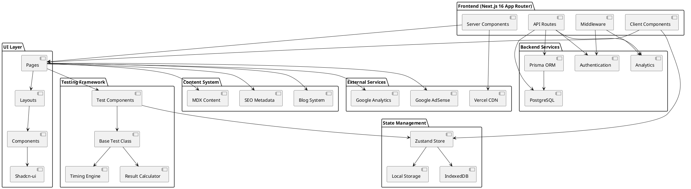
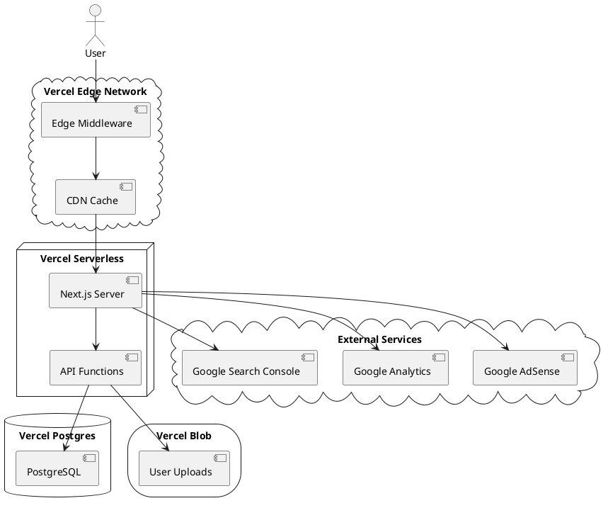
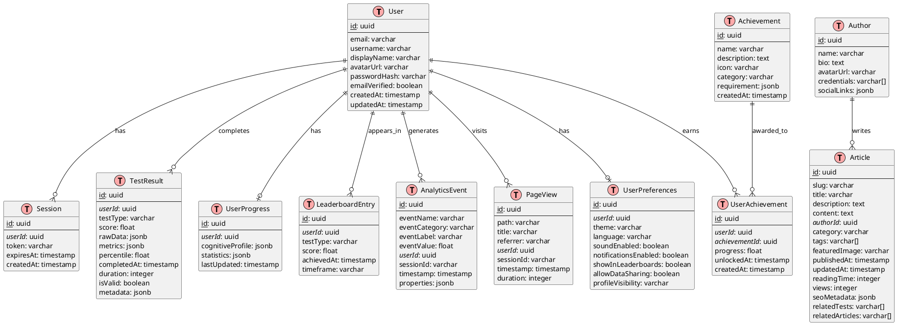
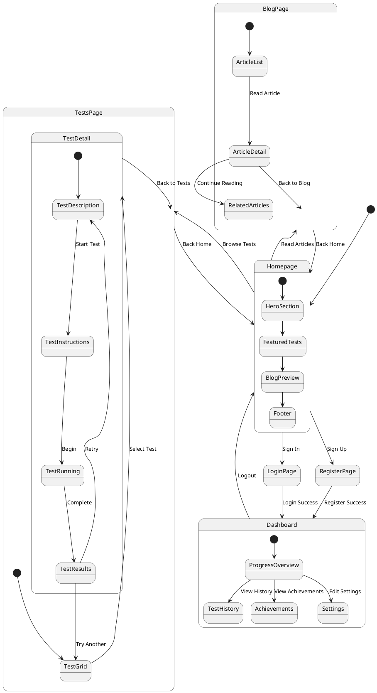
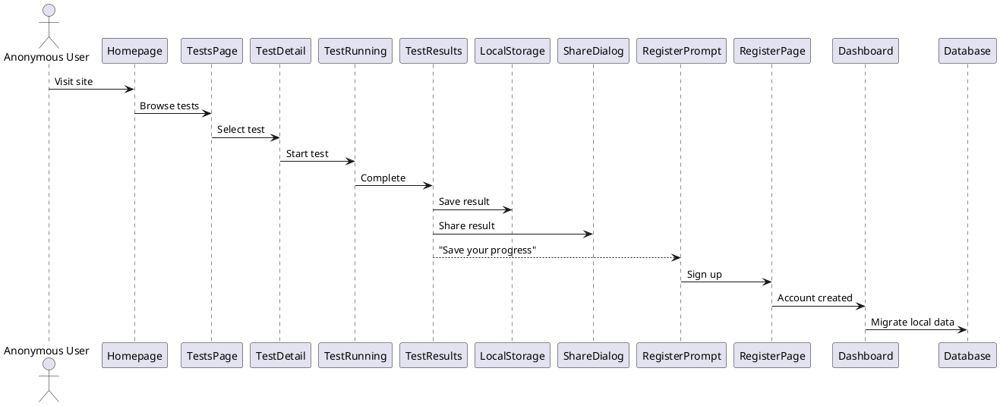
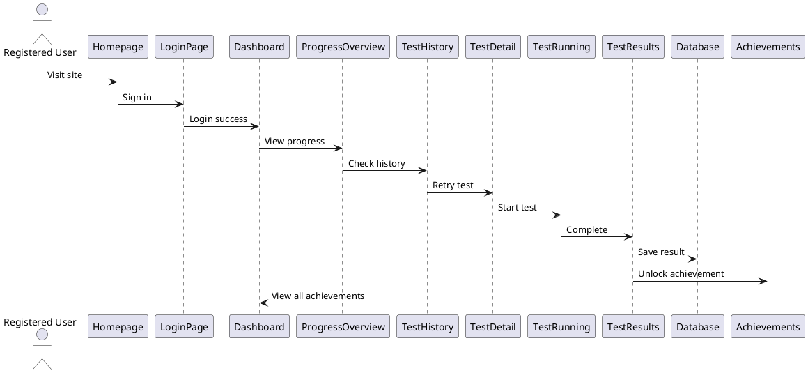
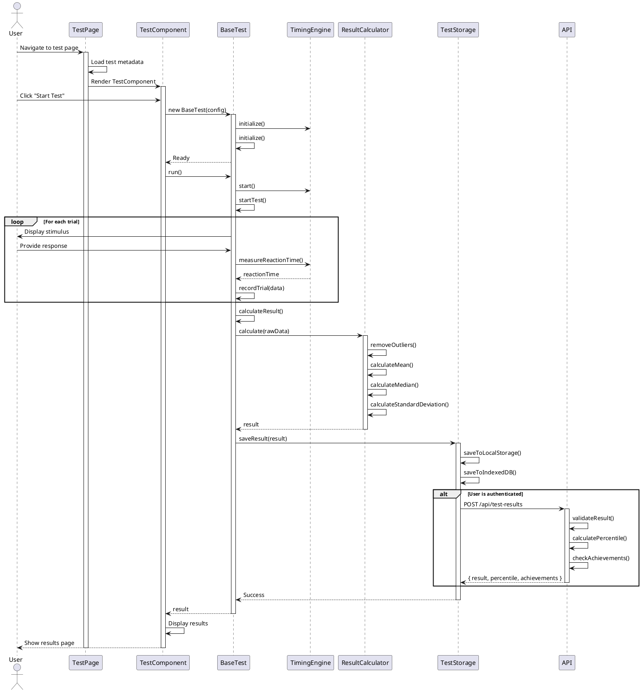
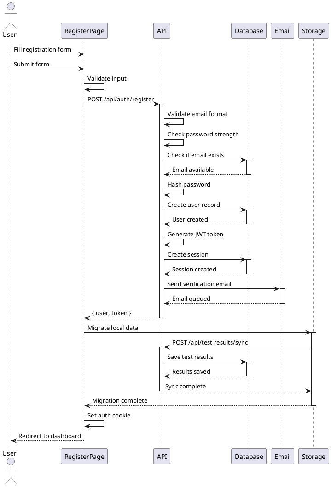
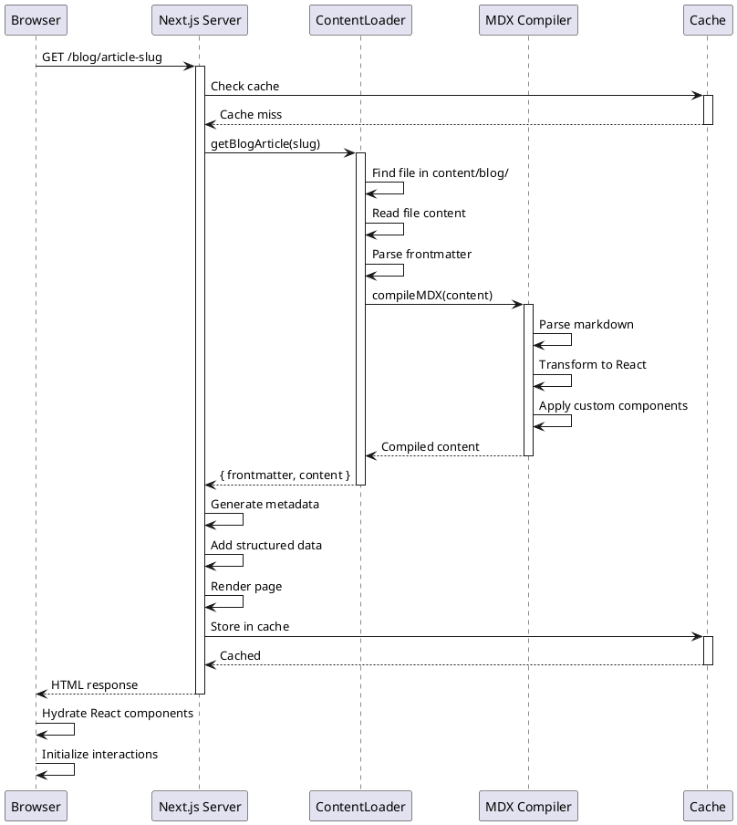

# ReflexTry Website Redesign - Software Architecture Document

**Version:** 1.0  
**Date:** January 27, 2026  
**Architect:** Bob  
**Project:** ReflexTry Redesign for Google AdSense Approval

---

## Table of Contents

1. [Implementation Approach](#1-implementation-approach)
2. [System Architecture](#2-system-architecture)
3. [UI/UX Design System](#3-uiux-design-system)
4. [Data Structures & Interfaces](#4-data-structures--interfaces)
5. [Cognitive Testing Architecture](#5-cognitive-testing-architecture)
6. [Database Schema](#6-database-schema)
7. [Content Management System](#7-content-management-system)
8. [API Design](#8-api-design)
9. [SEO Optimization Architecture](#9-seo-optimization-architecture)
10. [Performance Optimization Strategy](#10-performance-optimization-strategy)
11. [Mobile-First Responsive Design](#11-mobile-first-responsive-design)
12. [Integration Architecture](#12-integration-architecture)
13. [UI Navigation Flow](#13-ui-navigation-flow)
14. [Program Call Flow](#14-program-call-flow)
15. [Unclear Aspects](#15-unclear-aspects)

---

## 1. Implementation Approach

### 1.1 Core Strategy

The ReflexTry redesign will transform the existing Next.js application into a comprehensive cognitive testing platform that meets Google AdSense content quality requirements while maintaining excellent user experience and performance.

**Key Implementation Priorities:**

1. **Content-First Architecture**: Build a robust content management system that supports 30+ pages of high-quality educational content with proper SEO optimization.

2. **Modular Testing Framework**: Create a flexible, extensible architecture for cognitive tests that allows easy addition of new tests while maintaining consistent UX and data collection.

3. **Progressive Enhancement**: Implement features that work for anonymous users with local storage, then enhance with cloud sync for registered users.

4. **Performance-Optimized**: Leverage Next.js 16 App Router features (Server Components, Streaming, Partial Prerendering) for optimal performance.

5. **SEO-Native Design**: Build SEO optimization into the core architecture rather than as an afterthought.

### 1.2 Technology Stack Rationale

**Frontend Framework: Next.js 16 (App Router)**
- Server Components for reduced JavaScript bundle size
- Built-in image optimization and font optimization
- Automatic code splitting and lazy loading
- Native SEO support with metadata API
- Streaming and Suspense for better UX

**UI Components: Shadcn-ui + Tailwind CSS**
- Accessible components (WCAG 2.1 AA compliant)
- Customizable design system
- Small bundle size (tree-shakeable)
- Consistent styling with utility-first CSS

**State Management: Zustand**
- Lightweight (already in dependencies)
- Simple API for global state
- TypeScript-first design
- No boilerplate

**Animations: Framer Motion**
- Declarative animations
- Gesture support for mobile
- Layout animations
- Performance optimized

**Backend: Next.js API Routes + PostgreSQL**
- Serverless functions for scalability
- PostgreSQL for relational data (user profiles, test results)
- Vercel Postgres for easy deployment
- Prisma ORM for type-safe database access

**Content Management: MDX + File-based CMS**
- Markdown with React components
- Version controlled content
- Fast build times
- No external CMS dependencies

### 1.3 Difficult Requirements & Solutions

**Challenge 1: Google AdSense "Low Value Content" Rejection**

*Solution:*
- Implement a content-rich architecture with 600+ words per test page
- Create a blog system with 1000+ word articles
- Add structured data (Schema.org) for rich snippets
- Implement comprehensive internal linking strategy
- Build FAQ sections with structured data for featured snippets

**Challenge 2: 10+ Interactive Cognitive Tests with Accurate Timing**

*Solution:*
- Use `performance.now()` for millisecond-accurate timing
- Implement Web Workers for computation-intensive tests
- Create a base test framework with standardized interfaces
- Use Canvas API for visual tests requiring precise rendering
- Implement anti-cheat measures (timing validation, focus detection)

**Challenge 3: User Progress Tracking (Anonymous + Registered)**

*Solution:*
- Dual storage strategy: localStorage for anonymous, PostgreSQL for registered
- Implement data migration when users register
- Use IndexedDB for larger datasets (test history)
- Sync strategy with conflict resolution

**Challenge 4: Performance with Rich Content and Animations**

*Solution:*
- Aggressive code splitting by route and component
- Lazy load Framer Motion animations
- Use Next.js Image component for all images
- Implement Intersection Observer for lazy loading
- Server Components for static content
- Client Components only where interactivity needed

**Challenge 5: SEO for Dynamic Test Results**

*Solution:*
- Static generation for test description pages
- Dynamic OG images for social sharing
- Structured data for test results
- Canonical URLs for all pages
- XML sitemap with priority and change frequency

---

## 2. System Architecture

### 2.1 High-Level Architecture Diagram



### 2.2 Component Architecture

```plantuml
@startuml
package "App Directory Structure" {
    [app/] as App
    [app/[locale]/] as Locale
    [app/[locale]/layout.tsx] as Layout
    [app/[locale]/page.tsx] as Home
    [app/[locale]/tests/] as Tests
    [app/[locale]/blog/] as Blog
    [app/[locale]/dashboard/] as Dashboard
    [app/api/] as APIRoutes
}

package "Components Library" {
    [components/ui/] as UIComp
    [components/tests/] as TestComp
    [components/layouts/] as LayoutComp
    [components/features/] as FeatureComp
}

package "Library Functions" {
    [lib/database/] as DBLib
    [lib/tests/] as TestLib
    [lib/content/] as ContentLib
    [lib/seo/] as SEOLib
    [lib/analytics/] as AnalyticsLib
}

package "Utilities" {
    [utils/storage/] as Storage
    [utils/validation/] as Validation
    [utils/formatting/] as Formatting
}

App --> Locale
Locale --> Layout
Locale --> Home
Locale --> Tests
Locale --> Blog
Locale --> Dashboard
App --> APIRoutes

Layout --> LayoutComp
Home --> FeatureComp
Tests --> TestComp
Blog --> FeatureComp
Dashboard --> FeatureComp

TestComp --> UIComp
FeatureComp --> UIComp
LayoutComp --> UIComp

APIRoutes --> DBLib
TestComp --> TestLib
Blog --> ContentLib
Layout --> SEOLib
APIRoutes --> AnalyticsLib

TestLib --> Storage
DBLib --> Validation
ContentLib --> Formatting

@enduml
```

### 2.3 Deployment Architecture



---

## 3. UI/UX Design System

### 3.1 Color Palette

**Base Colors (Light Mode):**
```typescript
const lightColors = {
  // Backgrounds
  background: '#f8fafc',      // Slate 50
  surface: '#ffffff',         // White
  surfaceHighlight: '#f1f5f9', // Slate 100
  
  // Text
  foreground: '#0f172a',      // Slate 900
  foregroundMuted: '#475569', // Slate 600
  foregroundSubtle: '#64748b', // Slate 500
  
  // Borders
  border: '#e2e8f0',          // Slate 200
  borderStrong: '#cbd5e1',    // Slate 300
  
  // Interactive
  primary: '#0ea5e9',         // Sky 500
  primaryHover: '#0284c7',    // Sky 600
  secondary: '#8b5cf6',       // Violet 500
  secondaryHover: '#7c3aed',  // Violet 600
  
  // Status
  success: '#10b981',         // Emerald 500
  warning: '#f59e0b',         // Amber 500
  error: '#ef4444',           // Red 500
  info: '#3b82f6',            // Blue 500
}
```

**Base Colors (Dark Mode):**
```typescript
const darkColors = {
  // Backgrounds
  background: '#0f172a',      // Slate 900
  surface: '#1e293b',         // Slate 800
  surfaceHighlight: '#334155', // Slate 700
  
  // Text
  foreground: '#f8fafc',      // Slate 50
  foregroundMuted: '#94a3b8', // Slate 400
  foregroundSubtle: '#64748b', // Slate 500
  
  // Borders
  border: '#334155',          // Slate 700
  borderStrong: '#475569',    // Slate 600
  
  // Interactive (same as light mode)
  primary: '#0ea5e9',
  primaryHover: '#38bdf8',
  secondary: '#8b5cf6',
  secondaryHover: '#a78bfa',
  
  // Status (same as light mode)
  success: '#10b981',
  warning: '#f59e0b',
  error: '#ef4444',
  info: '#3b82f6',
}
```

**Accent Colors (Gen Z Neon Palette):**
```typescript
const accentColors = {
  neonTeal: '#00f0ff',
  electricPurple: '#9d00ff',
  vibrantCoral: '#ff4d4d',
  neonYellow: '#ccff00',
}
```

### 3.2 Typography System

**Font Family:**
```typescript
const fonts = {
  sans: ['Outfit', 'Inter', 'system-ui', 'sans-serif'],
  mono: ['JetBrains Mono', 'Fira Code', 'monospace'],
}
```

**Type Scale:**
```typescript
const typography = {
  // Display (Hero sections)
  display: {
    fontSize: '3.5rem',      // 56px
    lineHeight: '1.1',
    fontWeight: '700',
    letterSpacing: '-0.02em',
  },
  
  // Headings
  h1: {
    fontSize: '2.5rem',      // 40px
    lineHeight: '1.2',
    fontWeight: '700',
    letterSpacing: '-0.01em',
  },
  h2: {
    fontSize: '2rem',        // 32px
    lineHeight: '1.25',
    fontWeight: '600',
    letterSpacing: '-0.01em',
  },
  h3: {
    fontSize: '1.5rem',      // 24px
    lineHeight: '1.3',
    fontWeight: '600',
  },
  h4: {
    fontSize: '1.25rem',     // 20px
    lineHeight: '1.4',
    fontWeight: '600',
  },
  
  // Body
  bodyLarge: {
    fontSize: '1.125rem',    // 18px
    lineHeight: '1.6',
    fontWeight: '400',
  },
  body: {
    fontSize: '1rem',        // 16px
    lineHeight: '1.6',
    fontWeight: '400',
  },
  bodySmall: {
    fontSize: '0.875rem',    // 14px
    lineHeight: '1.5',
    fontWeight: '400',
  },
  
  // UI Elements
  button: {
    fontSize: '1rem',
    lineHeight: '1.5',
    fontWeight: '600',
    letterSpacing: '0.01em',
  },
  caption: {
    fontSize: '0.75rem',     // 12px
    lineHeight: '1.4',
    fontWeight: '500',
  },
}
```

**Responsive Typography:**
```typescript
const responsiveTypography = {
  display: {
    mobile: '2rem',          // 32px
    tablet: '2.75rem',       // 44px
    desktop: '3.5rem',       // 56px
  },
  h1: {
    mobile: '1.75rem',       // 28px
    tablet: '2rem',          // 32px
    desktop: '2.5rem',       // 40px
  },
  h2: {
    mobile: '1.5rem',        // 24px
    tablet: '1.75rem',       // 28px
    desktop: '2rem',         // 32px
  },
}
```

### 3.3 Spacing System

**Base Unit: 4px (0.25rem)**

```typescript
const spacing = {
  0: '0',
  1: '0.25rem',    // 4px
  2: '0.5rem',     // 8px
  3: '0.75rem',    // 12px
  4: '1rem',       // 16px
  5: '1.25rem',    // 20px
  6: '1.5rem',     // 24px
  8: '2rem',       // 32px
  10: '2.5rem',    // 40px
  12: '3rem',      // 48px
  16: '4rem',      // 64px
  20: '5rem',      // 80px
  24: '6rem',      // 96px
  32: '8rem',      // 128px
}
```

**Layout Spacing:**
```typescript
const layoutSpacing = {
  sectionPadding: {
    mobile: '3rem',      // 48px
    tablet: '4rem',      // 64px
    desktop: '5rem',     // 80px
  },
  containerPadding: {
    mobile: '1rem',      // 16px
    tablet: '1.5rem',    // 24px
    desktop: '2rem',     // 32px
  },
  componentGap: {
    tight: '0.5rem',     // 8px
    normal: '1rem',      // 16px
    relaxed: '1.5rem',   // 24px
    loose: '2rem',       // 32px
  },
}
```

### 3.4 Border Radius System

```typescript
const borderRadius = {
  none: '0',
  sm: '0.25rem',       // 4px
  md: '0.5rem',        // 8px
  lg: '0.75rem',       // 12px
  xl: '1rem',          // 16px
  '2xl': '1.5rem',     // 24px
  full: '9999px',
}
```

### 3.5 Shadow System

```typescript
const shadows = {
  sm: '0 1px 2px 0 rgba(0, 0, 0, 0.05)',
  md: '0 4px 6px -1px rgba(0, 0, 0, 0.1), 0 2px 4px -1px rgba(0, 0, 0, 0.06)',
  lg: '0 10px 15px -3px rgba(0, 0, 0, 0.1), 0 4px 6px -2px rgba(0, 0, 0, 0.05)',
  xl: '0 20px 25px -5px rgba(0, 0, 0, 0.1), 0 10px 10px -5px rgba(0, 0, 0, 0.04)',
  '2xl': '0 25px 50px -12px rgba(0, 0, 0, 0.25)',
  inner: 'inset 0 2px 4px 0 rgba(0, 0, 0, 0.06)',
  
  // Glow effects for neon accents
  glowTeal: '0 0 20px rgba(0, 240, 255, 0.5)',
  glowPurple: '0 0 20px rgba(157, 0, 255, 0.5)',
  glowCoral: '0 0 20px rgba(255, 77, 77, 0.5)',
}
```

### 3.6 Animation Guidelines

**Duration:**
```typescript
const duration = {
  fast: '150ms',
  normal: '300ms',
  slow: '500ms',
  slower: '700ms',
}
```

**Easing:**
```typescript
const easing = {
  easeIn: 'cubic-bezier(0.4, 0, 1, 1)',
  easeOut: 'cubic-bezier(0, 0, 0.2, 1)',
  easeInOut: 'cubic-bezier(0.4, 0, 0.2, 1)',
  spring: 'cubic-bezier(0.68, -0.55, 0.265, 1.55)',
}
```

**Common Animations:**
```typescript
const animations = {
  // Fade
  fadeIn: {
    initial: { opacity: 0 },
    animate: { opacity: 1 },
    exit: { opacity: 0 },
    transition: { duration: 0.3 },
  },
  
  // Slide
  slideUp: {
    initial: { y: 20, opacity: 0 },
    animate: { y: 0, opacity: 1 },
    exit: { y: -20, opacity: 0 },
    transition: { duration: 0.3 },
  },
  
  // Scale
  scaleIn: {
    initial: { scale: 0.9, opacity: 0 },
    animate: { scale: 1, opacity: 1 },
    exit: { scale: 0.9, opacity: 0 },
    transition: { duration: 0.3 },
  },
  
  // Hover
  hoverScale: {
    whileHover: { scale: 1.05 },
    whileTap: { scale: 0.95 },
    transition: { duration: 0.15 },
  },
  
  // Float (for hero elements)
  float: {
    animate: {
      y: [0, -20, 0],
    },
    transition: {
      duration: 6,
      repeat: Infinity,
      ease: 'easeInOut',
    },
  },
}
```

**Animation Best Practices:**
1. Use `transform` and `opacity` for best performance
2. Avoid animating `width`, `height`, `top`, `left`
3. Use `will-change` sparingly
4. Prefer CSS animations for simple transitions
5. Use Framer Motion for complex orchestrations
6. Respect `prefers-reduced-motion` media query

### 3.7 Component Library Structure

**Base Components (Shadcn-ui):**
```
components/ui/
├── button.tsx
├── card.tsx
├── input.tsx
├── label.tsx
├── select.tsx
├── textarea.tsx
├── dialog.tsx
├── dropdown-menu.tsx
├── tabs.tsx
├── badge.tsx
├── progress.tsx
├── toast.tsx
├── tooltip.tsx
├── skeleton.tsx
└── separator.tsx
```

**Custom Components:**
```
components/
├── layouts/
│   ├── navbar.tsx
│   ├── footer.tsx
│   ├── sidebar.tsx
│   └── container.tsx
├── features/
│   ├── test-card.tsx
│   ├── result-chart.tsx
│   ├── achievement-badge.tsx
│   ├── progress-tracker.tsx
│   ├── leaderboard.tsx
│   └── share-button.tsx
├── tests/
│   ├── base-test.tsx
│   ├── test-timer.tsx
│   ├── test-instructions.tsx
│   ├── test-results.tsx
│   └── test-controls.tsx
└── content/
    ├── article-card.tsx
    ├── table-of-contents.tsx
    ├── related-content.tsx
    └── author-bio.tsx
```

### 3.8 Responsive Breakpoints

```typescript
const breakpoints = {
  sm: '640px',    // Mobile landscape
  md: '768px',    // Tablet
  lg: '1024px',   // Desktop
  xl: '1280px',   // Large desktop
  '2xl': '1536px', // Extra large desktop
}
```

**Usage Pattern:**
```typescript
// Mobile-first approach
const responsiveStyles = {
  // Base (mobile)
  padding: '1rem',
  fontSize: '1rem',
  
  // Tablet and up
  '@media (min-width: 768px)': {
    padding: '1.5rem',
    fontSize: '1.125rem',
  },
  
  // Desktop and up
  '@media (min-width: 1024px)': {
    padding: '2rem',
    fontSize: '1.25rem',
  },
}
```

---

## 4. Data Structures & Interfaces

### 4.1 Core Type Definitions

```typescript
// ============================================
// User & Authentication Types
// ============================================

interface User {
  id: string;
  email: string;
  username: string;
  displayName: string | null;
  avatarUrl: string | null;
  createdAt: Date;
  updatedAt: Date;
  emailVerified: boolean;
  preferences: UserPreferences;
}

interface UserPreferences {
  theme: 'light' | 'dark' | 'system';
  language: string;
  soundEnabled: boolean;
  notificationsEnabled: boolean;
  privacySettings: PrivacySettings;
}

interface PrivacySettings {
  showInLeaderboards: boolean;
  allowDataSharing: boolean;
  profileVisibility: 'public' | 'private' | 'friends';
}

// ============================================
// Test Framework Types
// ============================================

interface BaseTest {
  id: string;
  type: TestType;
  name: string;
  description: string;
  category: TestCategory;
  difficulty: TestDifficulty;
  estimatedDuration: number; // in seconds
  instructions: string[];
  metadata: TestMetadata;
}

type TestType = 
  | 'reaction-time'
  | 'typing-speed'
  | 'verbal-memory'
  | 'number-memory'
  | 'sequence-memory'
  | 'chimp-test'
  | 'visual-acuity'
  | 'attention-span'
  | 'processing-speed'
  | 'mental-rotation';

type TestCategory = 
  | 'memory'
  | 'attention'
  | 'speed'
  | 'reasoning'
  | 'perception';

type TestDifficulty = 'easy' | 'medium' | 'hard' | 'adaptive';

interface TestMetadata {
  version: string;
  author: string;
  scientificReferences: string[];
  tags: string[];
}

// ============================================
// Test Configuration Types
// ============================================

interface TestConfig {
  testId: string;
  settings: TestSettings;
  calibration?: CalibrationData;
}

interface TestSettings {
  duration?: number;
  trials?: number;
  difficulty?: TestDifficulty;
  soundEnabled?: boolean;
  showFeedback?: boolean;
  customOptions?: Record<string, unknown>;
}

interface CalibrationData {
  screenSize: { width: number; height: number };
  pixelDensity: number;
  viewingDistance?: number;
  inputDevice: 'mouse' | 'touch' | 'keyboard';
}

// ============================================
// Test Result Types
// ============================================

interface TestResult {
  id: string;
  userId: string | null; // null for anonymous users
  testId: string;
  testType: TestType;
  score: number;
  rawData: TestRawData;
  metrics: TestMetrics;
  percentile: number | null;
  completedAt: Date;
  duration: number; // actual time taken in seconds
  isValid: boolean; // false if cheating detected
  metadata: ResultMetadata;
}

interface TestRawData {
  trials: TrialData[];
  settings: TestSettings;
  environment: EnvironmentData;
}

interface TrialData {
  trialNumber: number;
  stimulus: unknown;
  response: unknown;
  reactionTime?: number;
  accuracy?: boolean;
  timestamp: number;
}

interface EnvironmentData {
  userAgent: string;
  screenResolution: string;
  deviceType: 'mobile' | 'tablet' | 'desktop';
  browserName: string;
  browserVersion: string;
}

interface TestMetrics {
  mean: number;
  median: number;
  standardDeviation: number;
  min: number;
  max: number;
  outliers: number[];
  consistencyScore: number;
}

interface ResultMetadata {
  testVersion: string;
  dataVersion: string;
  processingTime: number;
  validationFlags: string[];
}

// ============================================
// Progress Tracking Types
// ============================================

interface UserProgress {
  userId: string;
  cognitiveProfile: CognitiveProfile;
  testHistory: TestHistorySummary[];
  achievements: Achievement[];
  statistics: UserStatistics;
  lastUpdated: Date;
}

interface CognitiveProfile {
  memory: DomainScore;
  attention: DomainScore;
  speed: DomainScore;
  reasoning: DomainScore;
  perception: DomainScore;
  overall: number;
}

interface DomainScore {
  score: number; // 0-100
  percentile: number;
  trend: 'improving' | 'stable' | 'declining';
  lastTestDate: Date;
  testCount: number;
}

interface TestHistorySummary {
  testType: TestType;
  attemptCount: number;
  bestScore: number;
  averageScore: number;
  latestScore: number;
  improvement: number; // percentage
  lastAttempt: Date;
}

interface Achievement {
  id: string;
  name: string;
  description: string;
  icon: string;
  category: AchievementCategory;
  unlockedAt: Date | null;
  progress: number; // 0-100
  requirement: AchievementRequirement;
}

type AchievementCategory = 
  | 'completion'
  | 'mastery'
  | 'consistency'
  | 'improvement'
  | 'exploration'
  | 'social'
  | 'special';

interface AchievementRequirement {
  type: string;
  target: number;
  current: number;
}

interface UserStatistics {
  totalTests: number;
  totalTime: number; // in seconds
  currentStreak: number;
  longestStreak: number;
  favoriteTest: TestType | null;
  joinDate: Date;
  level: number;
  experience: number;
  nextLevelXP: number;
}

// ============================================
// Leaderboard Types
// ============================================

interface LeaderboardEntry {
  rank: number;
  userId: string;
  username: string;
  displayName: string;
  avatarUrl: string | null;
  score: number;
  testType: TestType;
  achievedAt: Date;
  isCurrentUser: boolean;
}

interface Leaderboard {
  testType: TestType;
  timeframe: 'daily' | 'weekly' | 'monthly' | 'all-time';
  entries: LeaderboardEntry[];
  totalEntries: number;
  lastUpdated: Date;
}

// ============================================
// Content Types
// ============================================

interface Article {
  id: string;
  slug: string;
  title: string;
  description: string;
  content: string; // MDX content
  author: Author;
  category: ArticleCategory;
  tags: string[];
  featuredImage: string;
  publishedAt: Date;
  updatedAt: Date;
  readingTime: number; // in minutes
  views: number;
  seo: SEOMetadata;
  relatedTests: TestType[];
  relatedArticles: string[]; // article IDs
}

type ArticleCategory = 
  | 'cognitive-science'
  | 'brain-training'
  | 'test-guides'
  | 'research'
  | 'practical-applications';

interface Author {
  id: string;
  name: string;
  bio: string;
  avatarUrl: string;
  credentials: string[];
  socialLinks: SocialLinks;
}

interface SocialLinks {
  twitter?: string;
  linkedin?: string;
  website?: string;
}

interface SEOMetadata {
  metaTitle: string;
  metaDescription: string;
  keywords: string[];
  ogImage: string;
  canonicalUrl: string;
  structuredData: Record<string, unknown>;
}

// ============================================
// Analytics Types
// ============================================

interface AnalyticsEvent {
  eventName: string;
  eventCategory: string;
  eventLabel?: string;
  eventValue?: number;
  userId?: string;
  sessionId: string;
  timestamp: Date;
  properties: Record<string, unknown>;
}

interface PageView {
  path: string;
  title: string;
  referrer: string;
  userId?: string;
  sessionId: string;
  timestamp: Date;
  duration?: number;
}

// ============================================
// API Response Types
// ============================================

interface APIResponse<T> {
  success: boolean;
  data?: T;
  error?: APIError;
  metadata?: ResponseMetadata;
}

interface APIError {
  code: string;
  message: string;
  details?: Record<string, unknown>;
}

interface ResponseMetadata {
  timestamp: Date;
  requestId: string;
  processingTime: number;
}

// ============================================
// Storage Types
// ============================================

interface LocalStorageData {
  anonymousId: string;
  testResults: TestResult[];
  preferences: UserPreferences;
  lastSync: Date | null;
}

interface IndexedDBSchema {
  testResults: TestResult;
  testHistory: TestHistorySummary;
  achievements: Achievement;
  cachedContent: Article;
}
```

### 4.2 Test-Specific Interfaces

```typescript
// ============================================
// Reaction Time Test
// ============================================

interface ReactionTimeConfig extends TestConfig {
  settings: {
    trials: number;
    stimulusType: 'visual' | 'auditory' | 'tactile';
    minDelay: number;
    maxDelay: number;
  };
}

interface ReactionTimeResult extends TestResult {
  rawData: {
    trials: ReactionTimeTrial[];
  };
  metrics: {
    mean: number;
    median: number;
    standardDeviation: number;
    falseStarts: number;
  };
}

interface ReactionTimeTrial extends TrialData {
  stimulus: {
    type: 'visual' | 'auditory' | 'tactile';
    delay: number;
  };
  response: {
    reactionTime: number;
    isFalseStart: boolean;
  };
}

// ============================================
// Typing Speed Test
// ============================================

interface TypingSpeedConfig extends TestConfig {
  settings: {
    duration: number;
    textType: 'quote' | 'paragraph' | 'code' | 'custom';
    text: string;
  };
}

interface TypingSpeedResult extends TestResult {
  rawData: {
    keystrokes: Keystroke[];
    text: string;
    typedText: string;
  };
  metrics: {
    wpm: number;
    rawWPM: number;
    accuracy: number;
    consistency: number;
    errorRate: number;
    keyboardHeatmap: Record<string, number>;
  };
}

interface Keystroke {
  key: string;
  timestamp: number;
  isCorrect: boolean;
  isBackspace: boolean;
}

// ============================================
// Verbal Memory Test
// ============================================

interface VerbalMemoryConfig extends TestConfig {
  settings: {
    wordCount: number;
    memorizeTime: number;
    recallType: 'free' | 'recognition';
    wordCategory: 'general' | 'nouns' | 'verbs' | 'adjectives';
  };
}

interface VerbalMemoryResult extends TestResult {
  rawData: {
    presentedWords: string[];
    recalledWords: string[];
    distractorWords?: string[];
  };
  metrics: {
    correctRecalls: number;
    totalWords: number;
    accuracy: number;
    serialPositionEffect: number[];
    semanticClustering: number;
  };
}

// ============================================
// Chimp Test
// ============================================

interface ChimpTestConfig extends TestConfig {
  settings: {
    startLevel: number;
    maxLevel: number;
    displayTime: number;
    gridSize: { rows: number; cols: number };
  };
}

interface ChimpTestResult extends TestResult {
  rawData: {
    trials: ChimpTestTrial[];
  };
  metrics: {
    maxLevel: number;
    averageLevel: number;
    totalCorrect: number;
    totalAttempts: number;
    averageReactionTime: number;
  };
}

interface ChimpTestTrial extends TrialData {
  stimulus: {
    level: number;
    numberPositions: Array<{ number: number; x: number; y: number }>;
  };
  response: {
    sequence: number[];
    isCorrect: boolean;
    reactionTime: number;
  };
}

// ============================================
// Visual Acuity Test
// ============================================

interface VisualAcuityConfig extends TestConfig {
  settings: {
    testType: 'snellen' | 'tumbling-e' | 'landolt-c';
    viewingDistance: number;
    screenSize: { width: number; height: number };
  };
}

interface VisualAcuityResult extends TestResult {
  rawData: {
    trials: VisualAcuityTrial[];
  };
  metrics: {
    visualAcuity: string; // e.g., "20/20"
    smallestSize: number;
    accuracy: number;
    confidenceLevel: number;
  };
}

interface VisualAcuityTrial extends TrialData {
  stimulus: {
    optotype: string;
    size: number;
    orientation?: number;
  };
  response: {
    answer: string;
    isCorrect: boolean;
  };
}

// ============================================
// Attention Span Test
// ============================================

interface AttentionSpanConfig extends TestConfig {
  settings: {
    duration: number;
    targetFrequency: number;
    distractorFrequency: number;
    stimulusType: 'visual' | 'auditory';
  };
}

interface AttentionSpanResult extends TestResult {
  rawData: {
    trials: AttentionSpanTrial[];
  };
  metrics: {
    hits: number;
    misses: number;
    falseAlarms: number;
    correctRejections: number;
    sensitivity: number; // d-prime
    responseTime: number;
    vigilanceDecrement: number;
  };
}

interface AttentionSpanTrial extends TrialData {
  stimulus: {
    type: 'target' | 'distractor';
    timestamp: number;
  };
  response: {
    responded: boolean;
    reactionTime?: number;
    isCorrect: boolean;
  };
}
```

---

## 5. Cognitive Testing Architecture

### 5.1 Base Test Framework

```typescript
// ============================================
// Abstract Base Test Class
// ============================================

abstract class BaseTest<TConfig extends TestConfig, TResult extends TestResult> {
  protected config: TConfig;
  protected state: TestState;
  protected timingEngine: TimingEngine;
  protected resultCalculator: ResultCalculator<TResult>;
  protected storage: TestStorage;
  
  constructor(config: TConfig) {
    this.config = config;
    this.state = new TestState();
    this.timingEngine = new TimingEngine();
    this.resultCalculator = this.createResultCalculator();
    this.storage = new TestStorage();
  }
  
  // Abstract methods to be implemented by specific tests
  abstract initialize(): Promise<void>;
  abstract startTest(): Promise<void>;
  abstract handleInput(input: unknown): void;
  abstract calculateResult(): TResult;
  abstract cleanup(): void;
  
  // Common methods
  async run(): Promise<TResult> {
    await this.initialize();
    await this.startTest();
    
    return new Promise((resolve) => {
      this.state.onComplete(() => {
        const result = this.calculateResult();
        this.saveResult(result);
        this.cleanup();
        resolve(result);
      });
    });
  }
  
  pause(): void {
    this.state.pause();
    this.timingEngine.pause();
  }
  
  resume(): void {
    this.state.resume();
    this.timingEngine.resume();
  }
  
  abort(): void {
    this.state.abort();
    this.cleanup();
  }
  
  protected async saveResult(result: TResult): Promise<void> {
    await this.storage.saveResult(result);
  }
  
  protected abstract createResultCalculator(): ResultCalculator<TResult>;
}

// ============================================
// Test State Management
// ============================================

class TestState {
  private status: 'idle' | 'running' | 'paused' | 'completed' | 'aborted';
  private currentTrial: number;
  private totalTrials: number;
  private startTime: number;
  private callbacks: Map<string, Function[]>;
  
  constructor() {
    this.status = 'idle';
    this.currentTrial = 0;
    this.totalTrials = 0;
    this.startTime = 0;
    this.callbacks = new Map();
  }
  
  start(totalTrials: number): void {
    this.status = 'running';
    this.totalTrials = totalTrials;
    this.currentTrial = 0;
    this.startTime = performance.now();
    this.emit('start');
  }
  
  nextTrial(): void {
    this.currentTrial++;
    this.emit('trialComplete', this.currentTrial);
    
    if (this.currentTrial >= this.totalTrials) {
      this.complete();
    }
  }
  
  complete(): void {
    this.status = 'completed';
    this.emit('complete');
  }
  
  pause(): void {
    if (this.status === 'running') {
      this.status = 'paused';
      this.emit('pause');
    }
  }
  
  resume(): void {
    if (this.status === 'paused') {
      this.status = 'running';
      this.emit('resume');
    }
  }
  
  abort(): void {
    this.status = 'aborted';
    this.emit('abort');
  }
  
  getProgress(): number {
    return this.totalTrials > 0 ? this.currentTrial / this.totalTrials : 0;
  }
  
  getElapsedTime(): number {
    return performance.now() - this.startTime;
  }
  
  on(event: string, callback: Function): void {
    if (!this.callbacks.has(event)) {
      this.callbacks.set(event, []);
    }
    this.callbacks.get(event)!.push(callback);
  }
  
  onComplete(callback: Function): void {
    this.on('complete', callback);
  }
  
  private emit(event: string, ...args: unknown[]): void {
    const callbacks = this.callbacks.get(event);
    if (callbacks) {
      callbacks.forEach(cb => cb(...args));
    }
  }
}

// ============================================
// Timing Engine
// ============================================

class TimingEngine {
  private startTime: number = 0;
  private pauseTime: number = 0;
  private totalPausedTime: number = 0;
  private isPaused: boolean = false;
  
  start(): void {
    this.startTime = performance.now();
    this.pauseTime = 0;
    this.totalPausedTime = 0;
    this.isPaused = false;
  }
  
  pause(): void {
    if (!this.isPaused) {
      this.pauseTime = performance.now();
      this.isPaused = true;
    }
  }
  
  resume(): void {
    if (this.isPaused) {
      this.totalPausedTime += performance.now() - this.pauseTime;
      this.isPaused = false;
    }
  }
  
  getElapsedTime(): number {
    const currentTime = performance.now();
    const elapsed = currentTime - this.startTime - this.totalPausedTime;
    return elapsed;
  }
  
  getCurrentTime(): number {
    return performance.now();
  }
  
  measureReactionTime(stimulusTime: number): number {
    const responseTime = performance.now();
    return responseTime - stimulusTime;
  }
}

// ============================================
// Result Calculator
// ============================================

abstract class ResultCalculator<TResult extends TestResult> {
  abstract calculate(rawData: TestRawData): TResult;
  
  protected calculateMean(values: number[]): number {
    return values.reduce((sum, val) => sum + val, 0) / values.length;
  }
  
  protected calculateMedian(values: number[]): number {
    const sorted = [...values].sort((a, b) => a - b);
    const mid = Math.floor(sorted.length / 2);
    return sorted.length % 2 === 0
      ? (sorted[mid - 1] + sorted[mid]) / 2
      : sorted[mid];
  }
  
  protected calculateStandardDeviation(values: number[]): number {
    const mean = this.calculateMean(values);
    const squaredDiffs = values.map(val => Math.pow(val - mean, 2));
    const variance = this.calculateMean(squaredDiffs);
    return Math.sqrt(variance);
  }
  
  protected removeOutliers(values: number[], threshold: number = 2): number[] {
    const mean = this.calculateMean(values);
    const sd = this.calculateStandardDeviation(values);
    return values.filter(val => Math.abs(val - mean) <= threshold * sd);
  }
  
  protected calculatePercentile(score: number, distribution: number[]): number {
    const sorted = [...distribution].sort((a, b) => a - b);
    const index = sorted.findIndex(val => val >= score);
    return index === -1 ? 100 : (index / sorted.length) * 100;
  }
}

// ============================================
// Test Storage
// ============================================

class TestStorage {
  private localStorageKey = 'reflextry_test_results';
  private dbName = 'ReflexTryDB';
  private dbVersion = 1;
  
  async saveResult(result: TestResult): Promise<void> {
    // Save to localStorage for anonymous users
    this.saveToLocalStorage(result);
    
    // Save to IndexedDB for better performance with large datasets
    await this.saveToIndexedDB(result);
    
    // If user is authenticated, sync to server
    if (result.userId) {
      await this.syncToServer(result);
    }
  }
  
  private saveToLocalStorage(result: TestResult): void {
    try {
      const existing = this.getFromLocalStorage();
      existing.push(result);
      
      // Keep only last 50 results in localStorage
      const trimmed = existing.slice(-50);
      localStorage.setItem(this.localStorageKey, JSON.stringify(trimmed));
    } catch (error) {
      console.error('Failed to save to localStorage:', error);
    }
  }
  
  private getFromLocalStorage(): TestResult[] {
    try {
      const data = localStorage.getItem(this.localStorageKey);
      return data ? JSON.parse(data) : [];
    } catch (error) {
      console.error('Failed to read from localStorage:', error);
      return [];
    }
  }
  
  private async saveToIndexedDB(result: TestResult): Promise<void> {
    const db = await this.openDB();
    const transaction = db.transaction(['testResults'], 'readwrite');
    const store = transaction.objectStore('testResults');
    store.add(result);
  }
  
  private async syncToServer(result: TestResult): Promise<void> {
    try {
      const response = await fetch('/api/test-results', {
        method: 'POST',
        headers: { 'Content-Type': 'application/json' },
        body: JSON.stringify(result),
      });
      
      if (!response.ok) {
        throw new Error('Failed to sync result to server');
      }
    } catch (error) {
      console.error('Failed to sync to server:', error);
      // Queue for retry
      this.queueForRetry(result);
    }
  }
  
  private async openDB(): Promise<IDBDatabase> {
    return new Promise((resolve, reject) => {
      const request = indexedDB.open(this.dbName, this.dbVersion);
      
      request.onerror = () => reject(request.error);
      request.onsuccess = () => resolve(request.result);
      
      request.onupgradeneeded = (event) => {
        const db = (event.target as IDBOpenDBRequest).result;
        if (!db.objectStoreNames.contains('testResults')) {
          db.createObjectStore('testResults', { keyPath: 'id' });
        }
      };
    });
  }
  
  private queueForRetry(result: TestResult): void {
    // Implementation for retry queue
    const queue = this.getRetryQueue();
    queue.push(result);
    localStorage.setItem('reflextry_retry_queue', JSON.stringify(queue));
  }
  
  private getRetryQueue(): TestResult[] {
    try {
      const data = localStorage.getItem('reflextry_retry_queue');
      return data ? JSON.parse(data) : [];
    } catch {
      return [];
    }
  }
}
```

### 5.2 Test Component Architecture

```typescript
// ============================================
// React Component Structure for Tests
// ============================================

interface TestComponentProps {
  testType: TestType;
  config?: Partial<TestConfig>;
  onComplete: (result: TestResult) => void;
  onExit: () => void;
}

const TestComponent: React.FC<TestComponentProps> = ({
  testType,
  config,
  onComplete,
  onExit,
}) => {
  const [phase, setPhase] = useState<'instructions' | 'calibration' | 'running' | 'results'>('instructions');
  const [result, setResult] = useState<TestResult | null>(null);
  const testInstance = useRef<BaseTest<any, any> | null>(null);
  
  const handleStart = async () => {
    setPhase('running');
    const test = createTest(testType, config);
    testInstance.current = test;
    
    const result = await test.run();
    setResult(result);
    setPhase('results');
    onComplete(result);
  };
  
  const handlePause = () => {
    testInstance.current?.pause();
  };
  
  const handleResume = () => {
    testInstance.current?.resume();
  };
  
  const handleAbort = () => {
    testInstance.current?.abort();
    onExit();
  };
  
  return (
    <div className="test-container">
      {phase === 'instructions' && (
        <TestInstructions
          testType={testType}
          onStart={handleStart}
          onExit={onExit}
        />
      )}
      
      {phase === 'running' && (
        <TestRunner
          testType={testType}
          onPause={handlePause}
          onResume={handleResume}
          onAbort={handleAbort}
        />
      )}
      
      {phase === 'results' && result && (
        <TestResults
          result={result}
          onRetry={handleStart}
          onExit={onExit}
        />
      )}
    </div>
  );
};

// Factory function to create test instances
function createTest(testType: TestType, config?: Partial<TestConfig>): BaseTest<any, any> {
  switch (testType) {
    case 'reaction-time':
      return new ReactionTimeTest(config as ReactionTimeConfig);
    case 'typing-speed':
      return new TypingSpeedTest(config as TypingSpeedConfig);
    case 'verbal-memory':
      return new VerbalMemoryTest(config as VerbalMemoryConfig);
    // ... other test types
    default:
      throw new Error(`Unknown test type: ${testType}`);
  }
}
```

---

## 6. Database Schema

### 6.1 PostgreSQL Schema (Prisma)

```prisma
// schema.prisma

generator client {
  provider = "prisma-client-js"
}

datasource db {
  provider = "postgresql"
  url      = env("DATABASE_URL")
}

// ============================================
// User & Authentication
// ============================================

model User {
  id            String    @id @default(cuid())
  email         String    @unique
  username      String    @unique
  displayName   String?
  avatarUrl     String?
  passwordHash  String
  emailVerified Boolean   @default(false)
  createdAt     DateTime  @default(now())
  updatedAt     DateTime  @updatedAt
  
  // Relations
  preferences   UserPreferences?
  testResults   TestResult[]
  achievements  UserAchievement[]
  progress      UserProgress?
  sessions      Session[]
  
  @@index([email])
  @@index([username])
}

model UserPreferences {
  id                    String  @id @default(cuid())
  userId                String  @unique
  theme                 String  @default("system")
  language              String  @default("en")
  soundEnabled          Boolean @default(true)
  notificationsEnabled  Boolean @default(true)
  showInLeaderboards    Boolean @default(true)
  allowDataSharing      Boolean @default(true)
  profileVisibility     String  @default("public")
  
  user User @relation(fields: [userId], references: [id], onDelete: Cascade)
  
  @@index([userId])
}

model Session {
  id        String   @id @default(cuid())
  userId    String
  token     String   @unique
  expiresAt DateTime
  createdAt DateTime @default(now())
  
  user User @relation(fields: [userId], references: [id], onDelete: Cascade)
  
  @@index([userId])
  @@index([token])
}

// ============================================
// Test Results
// ============================================

model TestResult {
  id          String   @id @default(cuid())
  userId      String?
  testType    String
  score       Float
  rawData     Json
  metrics     Json
  percentile  Float?
  completedAt DateTime @default(now())
  duration    Int
  isValid     Boolean  @default(true)
  metadata    Json
  
  user User? @relation(fields: [userId], references: [id], onDelete: SetNull)
  
  @@index([userId])
  @@index([testType])
  @@index([completedAt])
  @@index([score])
}

// ============================================
// User Progress
// ============================================

model UserProgress {
  id              String   @id @default(cuid())
  userId          String   @unique
  cognitiveProfile Json
  statistics      Json
  lastUpdated     DateTime @updatedAt
  
  user User @relation(fields: [userId], references: [id], onDelete: Cascade)
  
  @@index([userId])
}

// ============================================
// Achievements
// ============================================

model Achievement {
  id          String   @id @default(cuid())
  name        String
  description String
  icon        String
  category    String
  requirement Json
  createdAt   DateTime @default(now())
  
  userAchievements UserAchievement[]
  
  @@index([category])
}

model UserAchievement {
  id            String    @id @default(cuid())
  userId        String
  achievementId String
  progress      Float     @default(0)
  unlockedAt    DateTime?
  createdAt     DateTime  @default(now())
  
  user        User        @relation(fields: [userId], references: [id], onDelete: Cascade)
  achievement Achievement @relation(fields: [achievementId], references: [id], onDelete: Cascade)
  
  @@unique([userId, achievementId])
  @@index([userId])
  @@index([achievementId])
}

// ============================================
// Leaderboards
// ============================================

model LeaderboardEntry {
  id          String   @id @default(cuid())
  userId      String
  testType    String
  score       Float
  achievedAt  DateTime @default(now())
  timeframe   String   // 'daily', 'weekly', 'monthly', 'all-time'
  
  @@index([testType, timeframe, score])
  @@index([userId])
}

// ============================================
// Content Management
// ============================================

model Article {
  id            String   @id @default(cuid())
  slug          String   @unique
  title         String
  description   String
  content       String   @db.Text
  authorId      String
  category      String
  tags          String[]
  featuredImage String
  publishedAt   DateTime
  updatedAt     DateTime @updatedAt
  readingTime   Int
  views         Int      @default(0)
  seoMetadata   Json
  relatedTests  String[]
  relatedArticles String[]
  
  author Author @relation(fields: [authorId], references: [id])
  
  @@index([slug])
  @@index([category])
  @@index([publishedAt])
}

model Author {
  id          String   @id @default(cuid())
  name        String
  bio         String
  avatarUrl   String
  credentials String[]
  socialLinks Json
  
  articles Article[]
}

// ============================================
// Analytics
// ============================================

model AnalyticsEvent {
  id            String   @id @default(cuid())
  eventName     String
  eventCategory String
  eventLabel    String?
  eventValue    Float?
  userId        String?
  sessionId     String
  timestamp     DateTime @default(now())
  properties    Json
  
  @@index([eventName])
  @@index([eventCategory])
  @@index([timestamp])
  @@index([userId])
}

model PageView {
  id        String   @id @default(cuid())
  path      String
  title     String
  referrer  String
  userId    String?
  sessionId String
  timestamp DateTime @default(now())
  duration  Int?
  
  @@index([path])
  @@index([timestamp])
  @@index([userId])
}
```

### 6.2 Database ER Diagram



---

## 7. Content Management System

### 7.1 File-Based Content Structure

```
content/
├── tests/
│   ├── reaction-time.mdx
│   ├── typing-speed.mdx
│   ├── verbal-memory.mdx
│   ├── number-memory.mdx
│   ├── sequence-memory.mdx
│   ├── chimp-test.mdx
│   ├── visual-acuity.mdx
│   ├── attention-span.mdx
│   ├── processing-speed.mdx
│   └── mental-rotation.mdx
├── blog/
│   ├── cognitive-science/
│   │   ├── how-memory-works.mdx
│   │   ├── neuroscience-of-attention.mdx
│   │   └── ...
│   ├── brain-training/
│   │   ├── evidence-based-brain-training.mdx
│   │   ├── daily-habits-cognitive-performance.mdx
│   │   └── ...
│   ├── test-guides/
│   │   ├── mastering-reaction-time.mdx
│   │   ├── improving-typing-speed.mdx
│   │   └── ...
│   └── research/
│       ├── latest-cognitive-psychology-research.mdx
│       └── ...
├── pages/
│   ├── about.mdx
│   ├── privacy-policy.mdx
│   ├── terms-of-service.mdx
│   └── contact.mdx
└── faqs/
    ├── general.mdx
    ├── tests.mdx
    └── science.mdx
```

### 7.2 MDX Content Schema

```typescript
// Frontmatter schema for test pages
interface TestPageFrontmatter {
  title: string;
  description: string;
  testType: TestType;
  category: TestCategory;
  difficulty: TestDifficulty;
  estimatedDuration: number;
  keywords: string[];
  relatedTests: string[];
  scientificReferences: Reference[];
  lastUpdated: string;
  author: string;
}

// Frontmatter schema for blog articles
interface ArticleFrontmatter {
  title: string;
  description: string;
  author: string;
  authorBio: string;
  category: ArticleCategory;
  tags: string[];
  featuredImage: string;
  publishedAt: string;
  updatedAt: string;
  readingTime: number;
  relatedTests: TestType[];
  relatedArticles: string[];
  seo: {
    metaTitle: string;
    metaDescription: string;
    keywords: string[];
    ogImage: string;
  };
}

interface Reference {
  title: string;
  authors: string[];
  journal: string;
  year: number;
  doi?: string;
  url?: string;
}
```

### 7.3 Content Loading System

```typescript
// lib/content/loader.ts

import fs from 'fs';
import path from 'path';
import matter from 'gray-matter';
import { compileMDX } from 'next-mdx-remote/rsc';

const contentDirectory = path.join(process.cwd(), 'content');

export async function getTestContent(testType: string) {
  const filePath = path.join(contentDirectory, 'tests', `${testType}.mdx`);
  const fileContent = fs.readFileSync(filePath, 'utf8');
  
  const { data, content } = matter(fileContent);
  const { content: mdxContent } = await compileMDX({
    source: content,
    options: { parseFrontmatter: true },
    components: mdxComponents,
  });
  
  return {
    frontmatter: data as TestPageFrontmatter,
    content: mdxContent,
  };
}

export async function getBlogArticle(slug: string) {
  const categories = ['cognitive-science', 'brain-training', 'test-guides', 'research'];
  
  for (const category of categories) {
    const filePath = path.join(contentDirectory, 'blog', category, `${slug}.mdx`);
    
    if (fs.existsSync(filePath)) {
      const fileContent = fs.readFileSync(filePath, 'utf8');
      const { data, content } = matter(fileContent);
      
      const { content: mdxContent } = await compileMDX({
        source: content,
        options: { parseFrontmatter: true },
        components: mdxComponents,
      });
      
      return {
        frontmatter: data as ArticleFrontmatter,
        content: mdxContent,
        category,
      };
    }
  }
  
  return null;
}

export async function getAllArticles() {
  const categories = ['cognitive-science', 'brain-training', 'test-guides', 'research'];
  const articles: Array<{ slug: string; frontmatter: ArticleFrontmatter; category: string }> = [];
  
  for (const category of categories) {
    const categoryPath = path.join(contentDirectory, 'blog', category);
    const files = fs.readdirSync(categoryPath);
    
    for (const file of files) {
      if (file.endsWith('.mdx')) {
        const filePath = path.join(categoryPath, file);
        const fileContent = fs.readFileSync(filePath, 'utf8');
        const { data } = matter(fileContent);
        
        articles.push({
          slug: file.replace('.mdx', ''),
          frontmatter: data as ArticleFrontmatter,
          category,
        });
      }
    }
  }
  
  return articles.sort((a, b) => 
    new Date(b.frontmatter.publishedAt).getTime() - 
    new Date(a.frontmatter.publishedAt).getTime()
  );
}

// Custom MDX components
const mdxComponents = {
  h1: (props: any) => <h1 className="text-4xl font-bold mb-4" {...props} />,
  h2: (props: any) => <h2 className="text-3xl font-semibold mb-3 mt-8" {...props} />,
  h3: (props: any) => <h3 className="text-2xl font-semibold mb-2 mt-6" {...props} />,
  p: (props: any) => <p className="mb-4 leading-relaxed" {...props} />,
  ul: (props: any) => <ul className="list-disc pl-6 mb-4" {...props} />,
  ol: (props: any) => <ol className="list-decimal pl-6 mb-4" {...props} />,
  li: (props: any) => <li className="mb-2" {...props} />,
  a: (props: any) => <a className="text-primary hover:underline" {...props} />,
  blockquote: (props: any) => (
    <blockquote className="border-l-4 border-primary pl-4 italic my-4" {...props} />
  ),
  code: (props: any) => (
    <code className="bg-surface px-2 py-1 rounded text-sm font-mono" {...props} />
  ),
  pre: (props: any) => (
    <pre className="bg-surface p-4 rounded-lg overflow-x-auto mb-4" {...props} />
  ),
};
```

---

## 8. API Design

### 8.1 API Route Structure

```
app/api/
├── auth/
│   ├── register/route.ts
│   ├── login/route.ts
│   ├── logout/route.ts
│   ├── verify-email/route.ts
│   └── reset-password/route.ts
├── users/
│   ├── [id]/route.ts
│   ├── [id]/preferences/route.ts
│   └── [id]/progress/route.ts
├── tests/
│   ├── [testType]/route.ts
│   ├── [testType]/config/route.ts
│   └── [testType]/leaderboard/route.ts
├── test-results/
│   ├── route.ts
│   ├── [id]/route.ts
│   └── sync/route.ts
├── achievements/
│   ├── route.ts
│   └── [id]/route.ts
├── leaderboards/
│   ├── [testType]/route.ts
│   └── [testType]/[timeframe]/route.ts
├── articles/
│   ├── route.ts
│   ├── [slug]/route.ts
│   └── [slug]/views/route.ts
└── analytics/
    ├── events/route.ts
    └── pageviews/route.ts
```

### 8.2 API Endpoints Specification

```typescript
// ============================================
// Authentication Endpoints
// ============================================

/**
 * POST /api/auth/register
 * Register a new user
 */
interface RegisterRequest {
  email: string;
  username: string;
  password: string;
  displayName?: string;
}

interface RegisterResponse {
  success: boolean;
  data?: {
    user: User;
    token: string;
  };
  error?: APIError;
}

/**
 * POST /api/auth/login
 * Login existing user
 */
interface LoginRequest {
  email: string;
  password: string;
}

interface LoginResponse {
  success: boolean;
  data?: {
    user: User;
    token: string;
  };
  error?: APIError;
}

// ============================================
// User Endpoints
// ============================================

/**
 * GET /api/users/[id]
 * Get user profile
 */
interface GetUserResponse {
  success: boolean;
  data?: User;
  error?: APIError;
}

/**
 * PATCH /api/users/[id]
 * Update user profile
 */
interface UpdateUserRequest {
  displayName?: string;
  avatarUrl?: string;
}

interface UpdateUserResponse {
  success: boolean;
  data?: User;
  error?: APIError;
}

/**
 * GET /api/users/[id]/progress
 * Get user progress and statistics
 */
interface GetProgressResponse {
  success: boolean;
  data?: UserProgress;
  error?: APIError;
}

/**
 * GET /api/users/[id]/preferences
 * Get user preferences
 */
interface GetPreferencesResponse {
  success: boolean;
  data?: UserPreferences;
  error?: APIError;
}

/**
 * PATCH /api/users/[id]/preferences
 * Update user preferences
 */
interface UpdatePreferencesRequest {
  theme?: 'light' | 'dark' | 'system';
  language?: string;
  soundEnabled?: boolean;
  notificationsEnabled?: boolean;
  privacySettings?: Partial<PrivacySettings>;
}

interface UpdatePreferencesResponse {
  success: boolean;
  data?: UserPreferences;
  error?: APIError;
}

// ============================================
// Test Result Endpoints
// ============================================

/**
 * POST /api/test-results
 * Submit a new test result
 */
interface SubmitResultRequest {
  testType: TestType;
  score: number;
  rawData: TestRawData;
  metrics: TestMetrics;
  duration: number;
  metadata: ResultMetadata;
}

interface SubmitResultResponse {
  success: boolean;
  data?: {
    result: TestResult;
    percentile: number;
    achievements: Achievement[];
  };
  error?: APIError;
}

/**
 * GET /api/test-results?userId=[id]&testType=[type]&limit=[n]
 * Get test results with filters
 */
interface GetResultsQuery {
  userId?: string;
  testType?: TestType;
  limit?: number;
  offset?: number;
  sortBy?: 'score' | 'date';
  order?: 'asc' | 'desc';
}

interface GetResultsResponse {
  success: boolean;
  data?: {
    results: TestResult[];
    total: number;
    hasMore: boolean;
  };
  error?: APIError;
}

/**
 * GET /api/test-results/[id]
 * Get specific test result
 */
interface GetResultResponse {
  success: boolean;
  data?: TestResult;
  error?: APIError;
}

/**
 * POST /api/test-results/sync
 * Sync local results to server
 */
interface SyncResultsRequest {
  results: TestResult[];
}

interface SyncResultsResponse {
  success: boolean;
  data?: {
    synced: number;
    failed: number;
    conflicts: TestResult[];
  };
  error?: APIError;
}

// ============================================
// Leaderboard Endpoints
// ============================================

/**
 * GET /api/leaderboards/[testType]/[timeframe]
 * Get leaderboard for specific test and timeframe
 */
interface GetLeaderboardQuery {
  limit?: number;
  offset?: number;
}

interface GetLeaderboardResponse {
  success: boolean;
  data?: Leaderboard;
  error?: APIError;
}

// ============================================
// Achievement Endpoints
// ============================================

/**
 * GET /api/achievements
 * Get all available achievements
 */
interface GetAchievementsResponse {
  success: boolean;
  data?: Achievement[];
  error?: APIError;
}

/**
 * GET /api/achievements?userId=[id]
 * Get user's achievements
 */
interface GetUserAchievementsResponse {
  success: boolean;
  data?: {
    achievements: Achievement[];
    progress: Record<string, number>;
  };
  error?: APIError;
}

// ============================================
// Article Endpoints
// ============================================

/**
 * GET /api/articles
 * Get all articles with filters
 */
interface GetArticlesQuery {
  category?: ArticleCategory;
  tag?: string;
  limit?: number;
  offset?: number;
}

interface GetArticlesResponse {
  success: boolean;
  data?: {
    articles: Article[];
    total: number;
    hasMore: boolean;
  };
  error?: APIError;
}

/**
 * GET /api/articles/[slug]
 * Get specific article
 */
interface GetArticleResponse {
  success: boolean;
  data?: Article;
  error?: APIError;
}

/**
 * POST /api/articles/[slug]/views
 * Increment article view count
 */
interface IncrementViewsResponse {
  success: boolean;
  data?: { views: number };
  error?: APIError;
}

// ============================================
// Analytics Endpoints
// ============================================

/**
 * POST /api/analytics/events
 * Track analytics event
 */
interface TrackEventRequest {
  eventName: string;
  eventCategory: string;
  eventLabel?: string;
  eventValue?: number;
  properties?: Record<string, unknown>;
}

interface TrackEventResponse {
  success: boolean;
  error?: APIError;
}

/**
 * POST /api/analytics/pageviews
 * Track page view
 */
interface TrackPageViewRequest {
  path: string;
  title: string;
  referrer: string;
}

interface TrackPageViewResponse {
  success: boolean;
  error?: APIError;
}
```

### 8.3 API Implementation Example

```typescript
// app/api/test-results/route.ts

import { NextRequest, NextResponse } from 'next/server';
import { prisma } from '@/lib/database';
import { validateTestResult } from '@/lib/validation';
import { calculatePercentile } from '@/lib/statistics';
import { checkAchievements } from '@/lib/achievements';

export async function POST(request: NextRequest) {
  try {
    const body = await request.json();
    const { testType, score, rawData, metrics, duration, metadata } = body;
    
    // Validate request
    const validation = validateTestResult(body);
    if (!validation.valid) {
      return NextResponse.json(
        { success: false, error: { code: 'VALIDATION_ERROR', message: validation.error } },
        { status: 400 }
      );
    }
    
    // Get user ID from session (if authenticated)
    const userId = await getUserIdFromSession(request);
    
    // Calculate percentile
    const percentile = await calculatePercentile(testType, score);
    
    // Save result
    const result = await prisma.testResult.create({
      data: {
        userId,
        testType,
        score,
        rawData,
        metrics,
        percentile,
        duration,
        metadata,
        isValid: true,
      },
    });
    
    // Check for new achievements
    let achievements: Achievement[] = [];
    if (userId) {
      achievements = await checkAchievements(userId, result);
      
      // Update user progress
      await updateUserProgress(userId, result);
    }
    
    return NextResponse.json({
      success: true,
      data: {
        result,
        percentile,
        achievements,
      },
    });
  } catch (error) {
    console.error('Error saving test result:', error);
    return NextResponse.json(
      { success: false, error: { code: 'INTERNAL_ERROR', message: 'Failed to save result' } },
      { status: 500 }
    );
  }
}

export async function GET(request: NextRequest) {
  try {
    const { searchParams } = new URL(request.url);
    const userId = searchParams.get('userId');
    const testType = searchParams.get('testType');
    const limit = parseInt(searchParams.get('limit') || '10');
    const offset = parseInt(searchParams.get('offset') || '0');
    
    const where: any = {};
    if (userId) where.userId = userId;
    if (testType) where.testType = testType;
    
    const [results, total] = await Promise.all([
      prisma.testResult.findMany({
        where,
        orderBy: { completedAt: 'desc' },
        take: limit,
        skip: offset,
      }),
      prisma.testResult.count({ where }),
    ]);
    
    return NextResponse.json({
      success: true,
      data: {
        results,
        total,
        hasMore: offset + limit < total,
      },
    });
  } catch (error) {
    console.error('Error fetching test results:', error);
    return NextResponse.json(
      { success: false, error: { code: 'INTERNAL_ERROR', message: 'Failed to fetch results' } },
      { status: 500 }
    );
  }
}
```

---

## 9. SEO Optimization Architecture

### 9.1 Metadata Generation System

```typescript
// lib/seo/metadata.ts

import { Metadata } from 'next';

interface SEOConfig {
  title: string;
  description: string;
  keywords?: string[];
  ogImage?: string;
  canonicalUrl?: string;
  noindex?: boolean;
  structuredData?: Record<string, unknown>;
}

export function generateMetadata(config: SEOConfig): Metadata {
  const {
    title,
    description,
    keywords = [],
    ogImage = '/og-image.png',
    canonicalUrl,
    noindex = false,
  } = config;
  
  const fullTitle = `${title} | ReflexTry - Cognitive Testing Platform`;
  const baseUrl = process.env.NEXT_PUBLIC_BASE_URL || 'https://www.reflextry.com';
  
  return {
    title: fullTitle,
    description,
    keywords: keywords.join(', '),
    authors: [{ name: 'ReflexTry Team' }],
    creator: 'ReflexTry',
    publisher: 'ReflexTry',
    robots: noindex ? 'noindex, nofollow' : 'index, follow',
    
    // Open Graph
    openGraph: {
      title: fullTitle,
      description,
      url: canonicalUrl || baseUrl,
      siteName: 'ReflexTry',
      images: [
        {
          url: ogImage,
          width: 1200,
          height: 630,
          alt: title,
        },
      ],
      locale: 'en_US',
      type: 'website',
    },
    
    // Twitter
    twitter: {
      card: 'summary_large_image',
      title: fullTitle,
      description,
      images: [ogImage],
      creator: '@reflextry',
    },
    
    // Canonical URL
    alternates: {
      canonical: canonicalUrl || baseUrl,
    },
    
    // Verification
    verification: {
      google: process.env.GOOGLE_SITE_VERIFICATION,
    },
  };
}

// Test page metadata
export function generateTestMetadata(testType: TestType, frontmatter: TestPageFrontmatter): Metadata {
  return generateMetadata({
    title: frontmatter.title,
    description: frontmatter.description,
    keywords: frontmatter.keywords,
    canonicalUrl: `https://www.reflextry.com/tests/${testType}`,
    structuredData: generateTestStructuredData(testType, frontmatter),
  });
}

// Article metadata
export function generateArticleMetadata(slug: string, frontmatter: ArticleFrontmatter): Metadata {
  return generateMetadata({
    title: frontmatter.seo.metaTitle || frontmatter.title,
    description: frontmatter.seo.metaDescription || frontmatter.description,
    keywords: frontmatter.seo.keywords,
    ogImage: frontmatter.seo.ogImage || frontmatter.featuredImage,
    canonicalUrl: `https://www.reflextry.com/blog/${slug}`,
    structuredData: generateArticleStructuredData(slug, frontmatter),
  });
}
```

### 9.2 Structured Data (Schema.org)

```typescript
// lib/seo/structured-data.ts

import { TestType, TestPageFrontmatter, ArticleFrontmatter } from '@/types';

export function generateTestStructuredData(testType: TestType, frontmatter: TestPageFrontmatter) {
  return {
    '@context': 'https://schema.org',
    '@type': 'WebApplication',
    name: frontmatter.title,
    description: frontmatter.description,
    url: `https://www.reflextry.com/tests/${testType}`,
    applicationCategory: 'HealthApplication',
    operatingSystem: 'Web',
    offers: {
      '@type': 'Offer',
      price: '0',
      priceCurrency: 'USD',
    },
    aggregateRating: {
      '@type': 'AggregateRating',
      ratingValue: '4.8',
      reviewCount: '1250',
    },
  };
}

export function generateArticleStructuredData(slug: string, frontmatter: ArticleFrontmatter) {
  return {
    '@context': 'https://schema.org',
    '@type': 'Article',
    headline: frontmatter.title,
    description: frontmatter.description,
    image: frontmatter.featuredImage,
    datePublished: frontmatter.publishedAt,
    dateModified: frontmatter.updatedAt,
    author: {
      '@type': 'Person',
      name: frontmatter.author,
      description: frontmatter.authorBio,
    },
    publisher: {
      '@type': 'Organization',
      name: 'ReflexTry',
      logo: {
        '@type': 'ImageObject',
        url: 'https://www.reflextry.com/logo.png',
      },
    },
    mainEntityOfPage: {
      '@type': 'WebPage',
      '@id': `https://www.reflextry.com/blog/${slug}`,
    },
  };
}

export function generateBreadcrumbStructuredData(items: Array<{ name: string; url: string }>) {
  return {
    '@context': 'https://schema.org',
    '@type': 'BreadcrumbList',
    itemListElement: items.map((item, index) => ({
      '@type': 'ListItem',
      position: index + 1,
      name: item.name,
      item: item.url,
    })),
  };
}

export function generateFAQStructuredData(faqs: Array<{ question: string; answer: string }>) {
  return {
    '@context': 'https://schema.org',
    '@type': 'FAQPage',
    mainEntity: faqs.map((faq) => ({
      '@type': 'Question',
      name: faq.question,
      acceptedAnswer: {
        '@type': 'Answer',
        text: faq.answer,
      },
    })),
  };
}

export function generateOrganizationStructuredData() {
  return {
    '@context': 'https://schema.org',
    '@type': 'Organization',
    name: 'ReflexTry',
    url: 'https://www.reflextry.com',
    logo: 'https://www.reflextry.com/logo.png',
    description: 'Free cognitive testing platform with science-backed assessments',
    sameAs: [
      'https://twitter.com/reflextry',
      'https://facebook.com/reflextry',
      'https://linkedin.com/company/reflextry',
    ],
    contactPoint: {
      '@type': 'ContactPoint',
      contactType: 'Customer Support',
      email: 'support@reflextry.com',
    },
  };
}
```

### 9.3 Sitemap Generation

```typescript
// app/sitemap.ts

import { MetadataRoute } from 'next';
import { getAllArticles } from '@/lib/content/loader';

const testTypes: TestType[] = [
  'reaction-time',
  'typing-speed',
  'verbal-memory',
  'number-memory',
  'sequence-memory',
  'chimp-test',
  'visual-acuity',
  'attention-span',
  'processing-speed',
  'mental-rotation',
];

export default async function sitemap(): Promise<MetadataRoute.Sitemap> {
  const baseUrl = 'https://www.reflextry.com';
  
  // Static pages
  const staticPages: MetadataRoute.Sitemap = [
    {
      url: baseUrl,
      lastModified: new Date(),
      changeFrequency: 'daily',
      priority: 1.0,
    },
    {
      url: `${baseUrl}/about`,
      lastModified: new Date(),
      changeFrequency: 'monthly',
      priority: 0.8,
    },
    {
      url: `${baseUrl}/blog`,
      lastModified: new Date(),
      changeFrequency: 'daily',
      priority: 0.9,
    },
    {
      url: `${baseUrl}/dashboard`,
      lastModified: new Date(),
      changeFrequency: 'weekly',
      priority: 0.7,
    },
  ];
  
  // Test pages
  const testPages: MetadataRoute.Sitemap = testTypes.map((testType) => ({
    url: `${baseUrl}/tests/${testType}`,
    lastModified: new Date(),
    changeFrequency: 'weekly',
    priority: 0.9,
  }));
  
  // Blog articles
  const articles = await getAllArticles();
  const articlePages: MetadataRoute.Sitemap = articles.map((article) => ({
    url: `${baseUrl}/blog/${article.slug}`,
    lastModified: new Date(article.frontmatter.updatedAt),
    changeFrequency: 'monthly',
    priority: 0.8,
  }));
  
  return [...staticPages, ...testPages, ...articlePages];
}
```

### 9.4 Robots.txt

```typescript
// app/robots.ts

import { MetadataRoute } from 'next';

export default function robots(): MetadataRoute.Robots {
  const baseUrl = 'https://www.reflextry.com';
  
  return {
    rules: [
      {
        userAgent: '*',
        allow: '/',
        disallow: ['/api/', '/dashboard/private/', '/_next/'],
      },
      {
        userAgent: 'GPTBot',
        allow: '/',
      },
    ],
    sitemap: `${baseUrl}/sitemap.xml`,
  };
}
```

---

## 10. Performance Optimization Strategy

### 10.1 Code Splitting & Lazy Loading

```typescript
// Lazy load heavy components
const TestRunner = dynamic(() => import('@/components/tests/test-runner'), {
  loading: () => <TestSkeleton />,
  ssr: false, // Client-side only
});

const ResultChart = dynamic(() => import('@/components/features/result-chart'), {
  loading: () => <ChartSkeleton />,
});

const FramerMotion = dynamic(() => import('framer-motion').then(mod => mod.motion), {
  ssr: false,
});

// Route-based code splitting (automatic with App Router)
// Each page in app/ directory is automatically code-split

// Component-level code splitting
const HeavyComponent = lazy(() => import('./heavy-component'));
```

### 10.2 Image Optimization

```typescript
// Use Next.js Image component for all images
import Image from 'next/image';

// Automatic optimization, lazy loading, and responsive images
<Image
  src="/test-image.jpg"
  alt="Test description"
  width={800}
  height={600}
  placeholder="blur"
  blurDataURL="data:image/jpeg;base64,..."
  priority={false} // Only true for above-the-fold images
  quality={85} // 75-85 is optimal
/>

// Generate blur placeholders at build time
import { getPlaiceholder } from 'plaiceholder';

async function getImageWithBlur(src: string) {
  const { base64 } = await getPlaiceholder(src);
  return { src, blurDataURL: base64 };
}
```

### 10.3 Font Optimization

```typescript
// app/layout.tsx

import { Outfit } from 'next/font/google';

// Optimize font loading
const outfit = Outfit({
  subsets: ['latin'],
  display: 'swap', // Use fallback font while loading
  variable: '--font-outfit',
  preload: true,
  fallback: ['system-ui', 'sans-serif'],
});

export default function RootLayout({ children }: { children: React.ReactNode }) {
  return (
    <html lang="en" className={outfit.variable}>
      <body>{children}</body>
    </html>
  );
}
```

### 10.4 Bundle Size Optimization

```typescript
// Analyze bundle size
// package.json
{
  "scripts": {
    "analyze": "ANALYZE=true next build"
  }
}

// next.config.ts
const withBundleAnalyzer = require('@next/bundle-analyzer')({
  enabled: process.env.ANALYZE === 'true',
});

// Tree-shaking: Import only what you need
import { Button } from '@/components/ui/button'; // ✓ Good
import * as UI from '@/components/ui'; // ✗ Bad

// Use dynamic imports for large libraries
const confetti = () => import('canvas-confetti').then(mod => mod.default);

// Remove unused dependencies
// Run: npx depcheck
```

### 10.5 Caching Strategy

```typescript
// Static page caching (ISR - Incremental Static Regeneration)
export const revalidate = 3600; // Revalidate every hour

// Dynamic page caching
export async function generateStaticParams() {
  const tests = await getTestTypes();
  return tests.map((test) => ({ testType: test }));
}

// API route caching
export async function GET(request: Request) {
  const data = await fetchData();
  
  return NextResponse.json(data, {
    headers: {
      'Cache-Control': 'public, s-maxage=3600, stale-while-revalidate=86400',
    },
  });
}

// Client-side caching with SWR
import useSWR from 'swr';

function useTestResults(userId: string) {
  const { data, error } = useSWR(
    `/api/test-results?userId=${userId}`,
    fetcher,
    {
      revalidateOnFocus: false,
      revalidateOnReconnect: false,
      dedupingInterval: 60000, // 1 minute
    }
  );
  
  return { results: data, isLoading: !error && !data, error };
}
```

### 10.6 Performance Monitoring

```typescript
// lib/performance/monitoring.ts

export function reportWebVitals(metric: NextWebVitalsMetric) {
  // Send to analytics
  if (metric.label === 'web-vital') {
    const { name, value, id } = metric;
    
    // Google Analytics
    gtag('event', name, {
      event_category: 'Web Vitals',
      event_label: id,
      value: Math.round(name === 'CLS' ? value * 1000 : value),
      non_interaction: true,
    });
    
    // Custom analytics
    fetch('/api/analytics/web-vitals', {
      method: 'POST',
      body: JSON.stringify({ name, value, id }),
      headers: { 'Content-Type': 'application/json' },
    });
  }
}

// Performance budget
const performanceBudget = {
  LCP: 2500, // Largest Contentful Paint < 2.5s
  FID: 100,  // First Input Delay < 100ms
  CLS: 0.1,  // Cumulative Layout Shift < 0.1
  FCP: 1800, // First Contentful Paint < 1.8s
  TTFB: 600, // Time to First Byte < 600ms
};

export function checkPerformanceBudget(metrics: Record<string, number>) {
  const violations = Object.entries(metrics)
    .filter(([key, value]) => value > performanceBudget[key as keyof typeof performanceBudget])
    .map(([key, value]) => ({ metric: key, value, budget: performanceBudget[key as keyof typeof performanceBudget] }));
  
  if (violations.length > 0) {
    console.warn('Performance budget violations:', violations);
  }
  
  return violations;
}
```

---

## 11. Mobile-First Responsive Design

### 11.1 Breakpoint Strategy

```typescript
// Tailwind CSS breakpoints (mobile-first)
const breakpoints = {
  // Base: 0-639px (mobile)
  sm: '640px',  // Mobile landscape, small tablets
  md: '768px',  // Tablets
  lg: '1024px', // Desktops
  xl: '1280px', // Large desktops
  '2xl': '1536px', // Extra large desktops
};

// Usage in components
<div className="
  px-4 py-6           // Mobile
  sm:px-6 sm:py-8     // Mobile landscape
  md:px-8 md:py-10    // Tablet
  lg:px-12 lg:py-12   // Desktop
  xl:px-16 xl:py-16   // Large desktop
">
  Content
</div>
```

### 11.2 Responsive Typography

```typescript
// Fluid typography using clamp()
const fluidTypography = {
  display: 'clamp(2rem, 5vw + 1rem, 3.5rem)',
  h1: 'clamp(1.75rem, 4vw + 1rem, 2.5rem)',
  h2: 'clamp(1.5rem, 3vw + 1rem, 2rem)',
  h3: 'clamp(1.25rem, 2vw + 1rem, 1.5rem)',
  body: 'clamp(0.875rem, 1vw + 0.5rem, 1rem)',
};

// Tailwind CSS responsive text
<h1 className="
  text-2xl sm:text-3xl md:text-4xl lg:text-5xl
  leading-tight
">
  Responsive Heading
</h1>
```

### 11.3 Touch-Friendly Interactions

```typescript
// Minimum touch target size: 44x44px (iOS), 48x48px (Android)
<button className="
  min-h-[44px] min-w-[44px]
  px-4 py-2
  touch-manipulation // Disable double-tap zoom
  active:scale-95    // Visual feedback on tap
  transition-transform
">
  Tap Me
</button>

// Swipe gestures with Framer Motion
import { motion, useMotionValue, useTransform } from 'framer-motion';

function SwipeableCard() {
  const x = useMotionValue(0);
  const opacity = useTransform(x, [-200, 0, 200], [0, 1, 0]);
  
  return (
    <motion.div
      drag="x"
      dragConstraints={{ left: 0, right: 0 }}
      style={{ x, opacity }}
      onDragEnd={(e, { offset, velocity }) => {
        if (Math.abs(offset.x) > 100) {
          // Handle swipe
        }
      }}
    >
      Card Content
    </motion.div>
  );
}
```

### 11.4 Responsive Images

```typescript
// Responsive images with art direction
<picture>
  <source
    media="(min-width: 1024px)"
    srcSet="/hero-desktop.jpg"
  />
  <source
    media="(min-width: 768px)"
    srcSet="/hero-tablet.jpg"
  />
  
</picture>

// Next.js Image with responsive sizes
<Image
  src="/test-image.jpg"
  alt="Test"
  width={800}
  height={600}
  sizes="(max-width: 768px) 100vw, (max-width: 1200px) 50vw, 33vw"
/>
```

### 11.5 Mobile Navigation

```typescript
// Mobile menu with slide-in animation
function MobileMenu() {
  const [isOpen, setIsOpen] = useState(false);
  
  return (
    <>
      {/* Hamburger button */}
      <button
        onClick={() => setIsOpen(true)}
        className="md:hidden p-2"
        aria-label="Open menu"
      >
        <MenuIcon />
      </button>
      
      {/* Overlay */}
      <AnimatePresence>
        {isOpen && (
          <>
            <motion.div
              initial={{ opacity: 0 }}
              animate={{ opacity: 1 }}
              exit={{ opacity: 0 }}
              onClick={() => setIsOpen(false)}
              className="fixed inset-0 bg-black/50 z-40 md:hidden"
            />
            
            {/* Menu */}
            <motion.nav
              initial={{ x: '-100%' }}
              animate={{ x: 0 }}
              exit={{ x: '-100%' }}
              transition={{ type: 'spring', damping: 25 }}
              className="fixed top-0 left-0 bottom-0 w-80 bg-white z-50 md:hidden"
            >
              <button
                onClick={() => setIsOpen(false)}
                className="absolute top-4 right-4"
                aria-label="Close menu"
              >
                <XIcon />
              </button>
              
              {/* Menu items */}
              <ul className="p-6 space-y-4">
                <li><Link href="/">Home</Link></li>
                <li><Link href="/tests">Tests</Link></li>
                <li><Link href="/blog">Blog</Link></li>
                <li><Link href="/about">About</Link></li>
              </ul>
            </motion.nav>
          </>
        )}
      </AnimatePresence>
    </>
  );
}
```

### 11.6 Responsive Test Interfaces

```typescript
// Adaptive test layout based on device
function TestInterface() {
  const isMobile = useMediaQuery('(max-width: 768px)');
  
  return (
    <div className="test-container">
      {isMobile ? (
        // Mobile layout: vertical stack
        <div className="flex flex-col space-y-4">
          <TestInstructions />
          <TestArea />
          <TestControls />
        </div>
      ) : (
        // Desktop layout: sidebar + main area
        <div className="grid grid-cols-[300px_1fr] gap-6">
          <aside>
            <TestInstructions />
            <TestControls />
          </aside>
          <main>
            <TestArea />
          </main>
        </div>
      )}
    </div>
  );
}

// Custom hook for media queries
function useMediaQuery(query: string) {
  const [matches, setMatches] = useState(false);
  
  useEffect(() => {
    const media = window.matchMedia(query);
    setMatches(media.matches);
    
    const listener = (e: MediaQueryListEvent) => setMatches(e.matches);
    media.addEventListener('change', listener);
    
    return () => media.removeEventListener('change', listener);
  }, [query]);
  
  return matches;
}
```

---

## 12. Integration Architecture

### 12.1 Google AdSense Integration

```typescript
// components/AdSense.tsx

'use client';

import { useEffect } from 'react';

interface AdSenseProps {
  adSlot: string;
  adFormat?: 'auto' | 'fluid' | 'rectangle' | 'vertical' | 'horizontal';
  fullWidthResponsive?: boolean;
  className?: string;
}

export function AdSense({
  adSlot,
  adFormat = 'auto',
  fullWidthResponsive = true,
  className = '',
}: AdSenseProps) {
  useEffect(() => {
    try {
      // @ts-ignore
      (window.adsbygoogle = window.adsbygoogle || []).push({});
    } catch (error) {
      console.error('AdSense error:', error);
    }
  }, []);
  
  return (
    <div className={`adsense-container ${className}`}>
      <ins
        className="adsbygoogle"
        style={{ display: 'block' }}
        data-ad-client={process.env.NEXT_PUBLIC_ADSENSE_CLIENT_ID}
        data-ad-slot={adSlot}
        data-ad-format={adFormat}
        data-full-width-responsive={fullWidthResponsive}
      />
    </div>
  );
}

// Ad placement strategy
const adPlacements = {
  // Homepage
  homepageHero: {
    slot: '1234567890',
    position: 'below-hero',
    minViewportHeight: 600,
  },
  
  // Test pages
  testPageTop: {
    slot: '2345678901',
    position: 'above-test',
    minViewportHeight: 500,
  },
  testPageSidebar: {
    slot: '3456789012',
    position: 'sidebar',
    format: 'vertical',
  },
  
  // Blog articles
  articleInContent: {
    slot: '4567890123',
    position: 'mid-article',
    paragraphIndex: 3,
  },
  articleSidebar: {
    slot: '5678901234',
    position: 'sidebar',
    format: 'vertical',
  },
};

// Lazy load ads for better performance
function LazyAd({ adSlot, ...props }: AdSenseProps) {
  const [isVisible, setIsVisible] = useState(false);
  const ref = useRef<HTMLDivElement>(null);
  
  useEffect(() => {
    const observer = new IntersectionObserver(
      ([entry]) => {
        if (entry.isIntersecting) {
          setIsVisible(true);
          observer.disconnect();
        }
      },
      { rootMargin: '200px' }
    );
    
    if (ref.current) {
      observer.observe(ref.current);
    }
    
    return () => observer.disconnect();
  }, []);
  
  return (
    <div ref={ref}>
      {isVisible && <AdSense adSlot={adSlot} {...props} />}
    </div>
  );
}
```

### 12.2 Google Analytics Integration

```typescript
// lib/analytics/google-analytics.ts

export const GA_TRACKING_ID = process.env.NEXT_PUBLIC_GA_TRACKING_ID;

// Track page views
export function pageview(url: string) {
  if (typeof window.gtag !== 'undefined') {
    window.gtag('config', GA_TRACKING_ID, {
      page_path: url,
    });
  }
}

// Track events
export function event({
  action,
  category,
  label,
  value,
}: {
  action: string;
  category: string;
  label?: string;
  value?: number;
}) {
  if (typeof window.gtag !== 'undefined') {
    window.gtag('event', action, {
      event_category: category,
      event_label: label,
      value: value,
    });
  }
}

// Track test completion
export function trackTestCompletion(testType: string, score: number, duration: number) {
  event({
    action: 'test_completed',
    category: 'Tests',
    label: testType,
    value: Math.round(score),
  });
  
  // Custom dimension for test duration
  if (typeof window.gtag !== 'undefined') {
    window.gtag('event', 'test_duration', {
      event_category: 'Tests',
      event_label: testType,
      value: duration,
    });
  }
}

// Track user registration
export function trackRegistration(method: string) {
  event({
    action: 'sign_up',
    category: 'User',
    label: method,
  });
}

// Track article views
export function trackArticleView(slug: string, category: string) {
  event({
    action: 'article_view',
    category: 'Content',
    label: `${category}/${slug}`,
  });
}

// components/GoogleAnalytics.tsx

'use client';

import Script from 'next/script';
import { usePathname, useSearchParams } from 'next/navigation';
import { useEffect } from 'react';
import { pageview, GA_TRACKING_ID } from '@/lib/analytics/google-analytics';

export function GoogleAnalytics() {
  const pathname = usePathname();
  const searchParams = useSearchParams();
  
  useEffect(() => {
    if (pathname) {
      pageview(pathname + searchParams.toString());
    }
  }, [pathname, searchParams]);
  
  if (!GA_TRACKING_ID) return null;
  
  return (
    <>
      <Script
        strategy="afterInteractive"
        src={`https://www.googletagmanager.com/gtag/js?id=${GA_TRACKING_ID}`}
      />
      <Script
        id="google-analytics"
        strategy="afterInteractive"
        dangerouslySetInnerHTML={{
          __html: `
            window.dataLayer = window.dataLayer || [];
            function gtag(){dataLayer.push(arguments);}
            gtag('js', new Date());
            gtag('config', '${GA_TRACKING_ID}', {
              page_path: window.location.pathname,
              anonymize_ip: true,
            });
          `,
        }}
      />
    </>
  );
}
```

### 12.3 Authentication Integration

```typescript
// lib/auth/session.ts

import { cookies } from 'next/headers';
import { SignJWT, jwtVerify } from 'jose';

const secretKey = new TextEncoder().encode(process.env.JWT_SECRET);

export async function createSession(userId: string): Promise<string> {
  const token = await new SignJWT({ userId })
    .setProtectedHeader({ alg: 'HS256' })
    .setIssuedAt()
    .setExpirationTime('7d')
    .sign(secretKey);
  
  cookies().set('session', token, {
    httpOnly: true,
    secure: process.env.NODE_ENV === 'production',
    sameSite: 'lax',
    maxAge: 60 * 60 * 24 * 7, // 7 days
    path: '/',
  });
  
  return token;
}

export async function getSession(): Promise<{ userId: string } | null> {
  const token = cookies().get('session')?.value;
  
  if (!token) return null;
  
  try {
    const { payload } = await jwtVerify(token, secretKey);
    return { userId: payload.userId as string };
  } catch {
    return null;
  }
}

export async function deleteSession() {
  cookies().delete('session');
}

// Middleware for protected routes
// middleware.ts

import { NextResponse } from 'next/server';
import type { NextRequest } from 'next/server';
import { getSession } from '@/lib/auth/session';

export async function middleware(request: NextRequest) {
  const session = await getSession();
  
  // Protected routes
  if (request.nextUrl.pathname.startsWith('/dashboard')) {
    if (!session) {
      return NextResponse.redirect(new URL('/login', request.url));
    }
  }
  
  // Redirect authenticated users away from auth pages
  if (request.nextUrl.pathname.startsWith('/login') || 
      request.nextUrl.pathname.startsWith('/register')) {
    if (session) {
      return NextResponse.redirect(new URL('/dashboard', request.url));
    }
  }
  
  return NextResponse.next();
}

export const config = {
  matcher: ['/dashboard/:path*', '/login', '/register'],
};
```

---

## 13. UI Navigation Flow

### 13.1 Navigation State Machine



### 13.2 User Journey Flows

**Anonymous User Journey:**


**Registered User Journey:**


---

## 14. Program Call Flow

### 14.1 Test Execution Sequence



### 14.2 User Registration Flow



### 14.3 Content Loading Flow



---

## 15. Unclear Aspects

### 15.1 Technical Decisions Requiring Clarification

**1. Database Choice for Production**
- **Question**: Should we use Vercel Postgres (managed) or self-hosted PostgreSQL?
- **Options**:
  - Vercel Postgres: Easy setup, automatic scaling, integrated with Vercel
  - Self-hosted: More control, potentially lower cost at scale
- **Recommendation**: Start with Vercel Postgres for simplicity, migrate if needed

**2. Real-time Features**
- **Question**: Do we need real-time leaderboard updates or is periodic refresh sufficient?
- **Options**:
  - WebSockets for real-time updates
  - Polling every 30-60 seconds
  - Static updates on page load
- **Recommendation**: Start with polling, add WebSockets if user demand exists

**3. Test Result Data Retention**
- **Question**: How long should we keep test results for anonymous users?
- **Options**:
  - 30 days (GDPR minimum)
  - 90 days (better for analytics)
  - Indefinitely (best for research)
- **Recommendation**: 90 days for anonymous, indefinite for registered users

**4. Image Generation for Tests**
- **Question**: Should we generate test images dynamically or use pre-generated assets?
- **Options**:
  - Dynamic generation (Canvas API): Flexible but slower
  - Pre-generated: Faster but less flexible
  - Hybrid: Pre-generate common, dynamic for custom
- **Recommendation**: Hybrid approach for optimal performance

### 15.2 Content Strategy Questions

**1. Content Update Frequency**
- **Question**: How often should we publish new blog articles?
- **Recommendation**: 2 articles per week initially, adjust based on traffic and resources

**2. Scientific Validation**
- **Question**: Should we partner with academic institutions for test validation?
- **Recommendation**: Yes, but start with literature citations, add partnerships later

**3. Multi-language Support**
- **Question**: Which languages should we prioritize after English?
- **Recommendation**: Spanish, French, German based on web traffic data

### 15.3 Business Model Questions

**1. Premium Features**
- **Question**: What features should be premium vs. free?
- **Recommendation**:
  - Free: All tests, basic progress tracking, educational content
  - Premium: Detailed reports, advanced analytics, ad-free, priority support

**2. AdSense Placement**
- **Question**: How many ads per page without hurting UX?
- **Recommendation**: 
  - Homepage: 2 ads (below hero, bottom)
  - Test pages: 1 ad (sidebar or below description)
  - Blog articles: 2 ads (mid-article, sidebar)
  - Results pages: 1 ad (below results)

**3. Data Monetization**
- **Question**: Can we use aggregated test data for research?
- **Recommendation**: Yes, with proper anonymization and user consent (opt-in)

### 15.4 Legal & Compliance Questions

**1. GDPR Compliance**
- **Question**: Do we need a Data Protection Officer (DPO)?
- **Recommendation**: Not required initially (< 250 employees), but implement GDPR-compliant practices

**2. Medical Disclaimers**
- **Question**: How strong should our medical disclaimers be?
- **Recommendation**: Very strong - clearly state tests are for entertainment/education, not medical diagnosis

**3. Age Restrictions**
- **Question**: Should we have age restrictions (COPPA compliance)?
- **Recommendation**: Require 13+ age or parental consent for accounts

### 15.5 Technical Infrastructure Questions

**1. CDN Strategy**
- **Question**: Should we use Vercel's built-in CDN or add Cloudflare?
- **Recommendation**: Start with Vercel CDN, add Cloudflare if we need advanced features (DDoS protection, workers)

**2. Monitoring & Alerting**
- **Question**: What monitoring tools should we use?
- **Recommendation**: 
  - Vercel Analytics for web vitals
  - Sentry for error tracking
  - Custom dashboard for business metrics

**3. Backup Strategy**
- **Question**: How often should we backup the database?
- **Recommendation**: 
  - Automated daily backups (Vercel Postgres includes this)
  - Weekly full backups to separate storage
  - Point-in-time recovery enabled

---

## Conclusion

This architecture document provides a comprehensive blueprint for the ReflexTry website redesign. The system is designed to:

1. **Meet Google AdSense Requirements**: Content-rich architecture with 30+ pages of high-quality educational material
2. **Deliver Excellent Performance**: Optimized for Core Web Vitals with Lighthouse scores > 90
3. **Scale Efficiently**: Serverless architecture with automatic scaling
4. **Provide Great UX**: Mobile-first responsive design with smooth animations
5. **Support Growth**: Modular architecture allowing easy addition of new tests and features

**Next Steps:**
1. Review and approve this architecture document
2. Set up development environment and infrastructure
3. Begin Phase 1 implementation (Foundation)
4. Create detailed component specifications
5. Start content creation in parallel with development

**Success Criteria:**
- Google AdSense approval within 18 weeks
- Lighthouse Performance score > 90
- 500+ daily active users within 3 months
- 80%+ test completion rate
- < 60% bounce rate

---

**Document Metadata:**
- **Version**: 1.0
- **Last Updated**: January 27, 2026
- **Author**: Bob (Architect)
- **Status**: Ready for Review
- **Related Documents**: 
  - Product Requirements Document (PRD)
  - Technical Specification (to be created)
  - Design System Documentation (to be created)