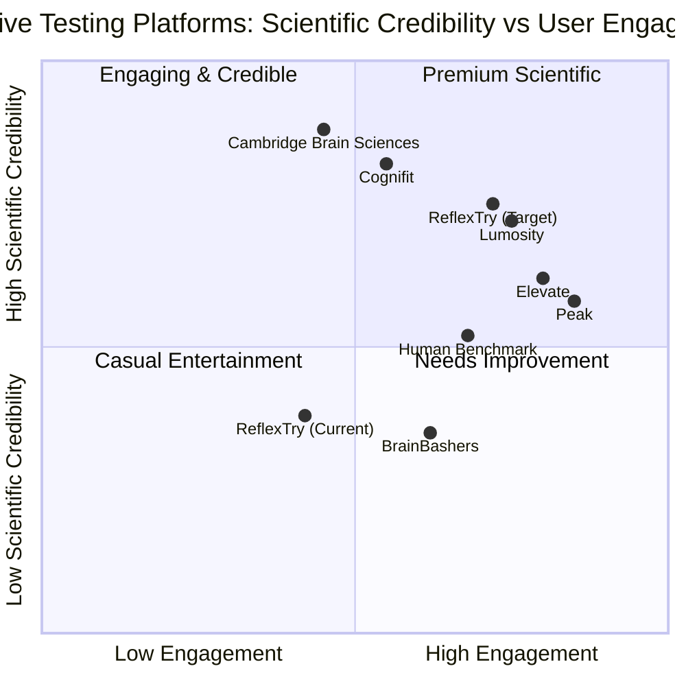

# Product Requirements Document (PRD)
# ReflexTry Website Redesign Project

**Document Version:** 1.0  
**Date:** January 27, 2026  
**Project Name:** reflextry_redesign  
**Programming Language:** Shadcn-ui, TypeScript, Tailwind CSS  
**Author:** Emma (Product Manager)

---

## Original Requirements Restatement

The ReflexTry website has been rejected by Google AdSense due to "low value content" issues. The site needs a comprehensive redesign to meet Google's publisher network criteria by:
- Enhancing UI/UX with modern design principles
- Adding 5-10 new interactive cognitive testing tools
- Implementing educational content about cognitive science
- Improving overall content quality and user experience
- Optimizing for SEO and AdSense approval

---

## 1. Product Definition

### 1.1 Product Goals

1. **Content Quality Enhancement**: Transform ReflexTry into a comprehensive cognitive testing platform with high-quality, unique content that meets Google AdSense standards and provides genuine educational value to users.

2. **User Engagement Optimization**: Create an interactive, scientifically-backed cognitive assessment ecosystem that keeps users engaged through gamification, progress tracking, and personalized insights while maintaining professional credibility.

3. **Market Positioning & Monetization**: Establish ReflexTry as a trusted authority in cognitive testing and brain training, achieving Google AdSense approval and building a sustainable revenue model through quality content and user retention.

### 1.2 User Stories

1. **As a student preparing for exams**, I want to practice various cognitive tests with detailed feedback so that I can identify and improve my weak areas in memory, attention, and processing speed.

2. **As a professional concerned about cognitive health**, I want to track my cognitive performance over time with scientific explanations so that I can monitor my mental sharpness and understand the science behind brain training.

3. **As a researcher or educator**, I want to access evidence-based cognitive assessment tools with educational content so that I can use them for teaching or personal research purposes.

4. **As a casual user interested in brain games**, I want to enjoy engaging cognitive challenges with achievements and social sharing so that I can compete with friends and stay motivated.

5. **As a content creator or blogger**, I want to discover high-quality cognitive science articles and testing tools so that I can share valuable resources with my audience and learn about cognitive psychology.

### 1.3 Competitive Analysis

**1. Lumosity (lumosity.com)**
- **Pros**: Extensive game library (50+ games), strong scientific backing, personalized training programs, excellent mobile apps, comprehensive progress tracking
- **Cons**: Expensive subscription ($11.99/month), limited free content, some games feel repetitive, heavy focus on monetization
- **Market Position**: Premium brain training leader

**2. Cambridge Brain Sciences (cambridgebrainsciences.com)**
- **Pros**: Research-grade assessments, used by academic institutions, detailed cognitive reports, scientifically validated tests, professional credibility
- **Cons**: Less gamified interface, limited free access, more clinical feel, smaller user community
- **Market Position**: Academic/professional cognitive assessment

**3. Human Benchmark (humanbenchmark.com)**
- **Pros**: Completely free, simple and fast tests, no registration required, clean interface, popular reaction time and memory tests
- **Cons**: Limited test variety, minimal educational content, basic UI design, no progress tracking for anonymous users
- **Market Position**: Free casual cognitive testing

**4. BrainBashers (brainbashers.com)**
- **Pros**: Large variety of puzzles and brain teasers, daily challenges, free access, long-established community
- **Cons**: Outdated design, heavy advertising, less focus on scientific cognitive testing, cluttered interface
- **Market Position**: Puzzle and brain teaser aggregator

**5. Cognifit (cognifit.com)**
- **Pros**: Clinical validation, personalized training, cognitive health focus, multiple languages, detailed assessments
- **Cons**: Expensive ($19.99/month), complex interface, overwhelming for casual users, aggressive marketing
- **Market Position**: Clinical cognitive training

**6. Peak (peak.net)**
- **Pros**: Beautiful mobile-first design, engaging gamification, good free tier, social features, Apple Design Award winner
- **Cons**: Mobile-focused (limited web), subscription required for full access, less educational content
- **Market Position**: Mobile brain training games

**7. Elevate (elevate.app)**
- **Pros**: Focus on practical skills (reading, writing, math), elegant design, adaptive difficulty, daily workout structure
- **Cons**: Mobile-only, subscription-based ($4.99/month), limited cognitive science depth
- **Market Position**: Practical skills training

### 1.4 Competitive Quadrant Chart



---

## 2. Current State Analysis

### 2.1 Existing Website Assessment

Based on the Google AdSense rejection for "low value content", the current ReflexTry website likely suffers from:

**Content Issues:**
- Insufficient unique, original content
- Lack of detailed explanations or educational material
- Minimal text content relative to interactive elements
- Missing comprehensive descriptions for tests
- No blog or article section
- Insufficient content depth per page

**UI/UX Issues:**
- Basic or outdated visual design
- Poor mobile responsiveness
- Limited interactive features
- Unclear navigation structure
- Lack of user engagement mechanisms
- No progress tracking or user accounts

**Technical Issues:**
- Thin content pages (< 300 words per page)
- Poor SEO optimization
- Missing meta descriptions and structured data
- Lack of internal linking structure
- No content update mechanism

**User Experience Gaps:**
- No personalization features
- Missing social proof or testimonials
- Lack of gamification elements
- No achievement or reward system
- Limited test variety

### 2.2 Google AdSense Rejection Analysis

**Primary Rejection Reason: "Low Value Content"**

This typically indicates:
1. **Insufficient Content Volume**: Pages need substantial, unique content (minimum 300-500 words per page)
2. **Lack of Original Value**: Content must provide unique insights, not just replicate existing tools
3. **Poor User Experience**: Site must offer clear value proposition and easy navigation
4. **Thin Affiliate Content**: Over-reliance on external links or minimal original content
5. **Content Quality**: Need for well-written, error-free, professionally presented content

**Requirements for AdSense Approval:**
- Minimum 20-30 high-quality pages
- Each page with 500+ words of unique content
- Clear site purpose and value proposition
- Professional design and navigation
- Regular content updates
- Privacy policy, terms of service, about page, contact page
- Mobile-friendly responsive design
- Fast loading times
- No copyright violations
- Original images and media

---

## 3. Technical Specifications

### 3.1 Requirements Analysis

The ReflexTry redesign requires a comprehensive transformation addressing multiple technical and content dimensions:

**Frontend Architecture:**
- Modern React-based framework with TypeScript for type safety
- Shadcn-ui component library for consistent, accessible UI components
- Tailwind CSS for responsive, utility-first styling
- State management for user progress and test results
- Real-time data visualization for test results
- Progressive Web App (PWA) capabilities for offline access

**Content Management:**
- Markdown-based content system for educational articles
- Dynamic content generation for test descriptions
- SEO-optimized page structure with proper meta tags
- Structured data markup (Schema.org) for cognitive tests
- Multi-language support architecture (future consideration)

**User Experience:**
- Authentication system for progress tracking
- Local storage for anonymous users
- Cloud sync for registered users
- Responsive design (mobile-first approach)
- Accessibility compliance (WCAG 2.1 AA)
- Performance optimization (< 3s load time)

**Testing Framework:**
- Modular test architecture for easy addition of new tests
- Standardized scoring algorithms
- Data validation and error handling
- Result visualization components
- Export functionality for test results

**Analytics & Tracking:**
- User behavior analytics
- Test completion rates
- Performance metrics
- A/B testing capability
- Conversion tracking for AdSense

**Content Strategy:**
- Minimum 30 unique pages at launch
- Educational blog with 20+ articles
- Comprehensive test descriptions (500+ words each)
- How-to guides and tutorials
- Scientific research references
- FAQ section with 50+ questions

### 3.2 Requirements Pool

#### P0 Requirements (Must-Have for Launch)

**Content & SEO:**
1. Create 10 core cognitive test pages with 500+ words each including scientific background, instructions, benefits, and interpretation
2. Develop 15 educational articles on cognitive science topics (1000+ words each)
3. Implement comprehensive About, Privacy Policy, Terms of Service, and Contact pages
4. Add FAQ section with minimum 30 questions covering tests, science, and usage
5. Implement proper meta tags, Open Graph tags, and structured data for all pages
6. Create XML sitemap and robots.txt for search engine optimization

**UI/UX Redesign:**
7. Implement responsive design supporting mobile, tablet, and desktop (breakpoints: 320px, 768px, 1024px, 1440px)
8. Design and implement modern homepage with clear value proposition and test showcase
9. Create intuitive navigation with mega menu showing test categories
10. Implement consistent design system using Shadcn-ui components with custom theme
11. Add smooth animations and transitions (page transitions, hover effects, loading states)
12. Design results pages with data visualization (charts, graphs, percentile rankings)

**Core Cognitive Tests (Minimum 8):**
13. Advanced Typing Speed Test with WPM, accuracy, error tracking, and text variety
14. Verbal Memory Test with word lists, recall phases, and difficulty levels
15. Chimp Test (number sequence memory) with progressive difficulty
16. Visual Acuity Test with Snellen chart and contrast sensitivity
17. Attention Span Test (sustained attention task) with distractor elements
18. Reaction Time Test with multiple stimuli types
19. Number Memory Test with digit span assessment
20. Sequence Memory Test with pattern recognition

**User Features:**
21. Anonymous user support with local storage for immediate testing
22. User registration and authentication system (email/password, social login)
23. Personal dashboard showing test history and progress
24. Test result storage and retrieval system
25. Basic progress charts showing improvement over time

**Technical Requirements:**
26. Implement performance optimization (code splitting, lazy loading, image optimization)
27. Add error handling and user-friendly error messages
28. Implement loading states and skeleton screens
29. Add print functionality for test results
30. Ensure cross-browser compatibility (Chrome, Firefox, Safari, Edge)

#### P1 Requirements (Should-Have for Full Launch)

**Enhanced Content:**
31. Add 10 additional educational articles on brain training techniques
32. Create video tutorials for each test (2-3 minutes each)
33. Implement blog system with categories and tags
34. Add scientific research references section with citations
35. Create glossary of cognitive science terms

**Advanced Testing Features:**
36. Processing Speed Test with symbol matching
37. Mental Rotation Test with 3D object manipulation
38. Dual N-Back Game for working memory training
39. Executive Function Test with task-switching scenarios
40. Color Blindness Test (Ishihara plates)
41. Test difficulty adjustment based on performance
42. Adaptive testing algorithms

**Gamification & Engagement:**
43. Achievement system with badges for milestones
44. Leaderboards for competitive tests (optional, privacy-respecting)
45. Daily challenges and streaks
46. Personalized test recommendations based on performance
47. Social sharing functionality for results (with privacy controls)
48. Progress notifications and motivational messages

**Analytics & Insights:**
49. Detailed cognitive profile with strengths and weaknesses
50. Comparison with age-group norms
51. Trend analysis showing improvement areas
52. Personalized training recommendations
53. Export test results as PDF reports

**User Experience Enhancements:**
54. Dark mode toggle
55. Customizable test settings (difficulty, duration, sound)
56. Test pause and resume functionality
57. Keyboard shortcuts for power users
58. Accessibility features (screen reader support, high contrast mode)

#### P2 Requirements (Nice-to-Have for Future Iterations)

**Advanced Features:**
59. AI-powered personalized training plans
60. Multi-user accounts for families or classrooms
61. API for third-party integrations
62. Mobile app development (iOS/Android)
63. Offline mode with PWA
64. Multi-language support (Spanish, French, German, Chinese)

**Community Features:**
65. User forums or discussion boards
66. Expert Q&A section
67. User-generated content (test reviews, tips)
68. Newsletter subscription system
69. Referral program

**Monetization:**
70. Premium subscription tier with advanced features
71. Ad-free experience option
72. Detailed cognitive reports (paid)
73. Corporate/educational licensing
74. Affiliate partnerships with brain health products

**Advanced Analytics:**
75. Machine learning for performance prediction
76. Cognitive decline detection algorithms
77. Integration with health tracking apps
78. Research participation opportunities
79. Data export for personal health records

### 3.3 UI Design Draft

#### Homepage Layout

```
┌─────────────────────────────────────────────────────────────┐
│ [Logo] ReflexTry        [Tests] [Learn] [About] [Sign In]  │
├─────────────────────────────────────────────────────────────┤
│                                                              │
│              Discover Your Cognitive Potential               │
│         Science-backed tests to measure and improve          │
│              your memory, attention, and speed               │
│                                                              │
│              [Start Free Testing] [Learn More]               │
│                                                              │
│         [Illustration: Brain with connected nodes]           │
│                                                              │
├─────────────────────────────────────────────────────────────┤
│                    Featured Tests                            │
│  ┌──────────┐  ┌──────────┐  ┌──────────┐  ┌──────────┐   │
│  │ Reaction │  │  Memory  │  │  Typing  │  │ Attention│   │
│  │   Time   │  │   Test   │  │  Speed   │  │   Span   │   │
│  │  [Icon]  │  │  [Icon]  │  │  [Icon]  │  │  [Icon]  │   │
│  │ 2.5M+    │  │ 1.8M+    │  │ 3.2M+    │  │ 890K+    │   │
│  │  tests   │  │  tests   │  │  tests   │  │  tests   │   │
│  └──────────┘  └──────────┘  └──────────┘  └──────────┘   │
│                                                              │
├─────────────────────────────────────────────────────────────┤
│              Why Cognitive Testing Matters                   │
│  [3-column layout with icons and descriptions]              │
│  • Track Your Progress  • Science-Backed  • Free Forever   │
│                                                              │
├─────────────────────────────────────────────────────────────┤
│                 Latest from Our Blog                         │
│  [3 article cards with images, titles, excerpts]           │
│                                                              │
├─────────────────────────────────────────────────────────────┤
│  Footer: About | Privacy | Terms | Contact | Social Links   │
└─────────────────────────────────────────────────────────────┘
```

#### Test Page Layout

```
┌─────────────────────────────────────────────────────────────┐
│ [Navigation Bar]                                             │
├─────────────────────────────────────────────────────────────┤
│                                                              │
│  Reaction Time Test                              [Start]    │
│                                                              │
│  ┌────────────────────────────────────────────────────┐    │
│  │                                                     │    │
│  │  What is Reaction Time?                            │    │
│  │  [500+ words of educational content explaining     │    │
│  │   the science, importance, and applications]       │    │
│  │                                                     │    │
│  │  How It Works:                                     │    │
│  │  [Detailed instructions with visuals]              │    │
│  │                                                     │    │
│  │  What Your Results Mean:                           │    │
│  │  [Interpretation guide with percentile ranges]     │    │
│  │                                                     │    │
│  │  Scientific Background:                            │    │
│  │  [Research references and cognitive science]       │    │
│  │                                                     │    │
│  │  Tips for Improvement:                             │    │
│  │  [Actionable advice for better performance]        │    │
│  │                                                     │    │
│  └────────────────────────────────────────────────────┘    │
│                                                              │
│  [Large CTA Button: Begin Test]                             │
│                                                              │
│  Related Tests: [Memory] [Attention] [Processing Speed]     │
│                                                              │
├─────────────────────────────────────────────────────────────┤
│  [Footer]                                                    │
└─────────────────────────────────────────────────────────────┘
```

#### Test Execution Screen

```
┌─────────────────────────────────────────────────────────────┐
│ Reaction Time Test                    [Pause] [Exit]        │
├─────────────────────────────────────────────────────────────┤
│                                                              │
│              Trial 3 of 5                                    │
│              ═══════════════════════════════                 │
│                                                              │
│                                                              │
│                  [Test Interface Area]                       │
│              (Click when screen turns green)                 │
│                                                              │
│                                                              │
│  Previous Results:                                           │
│  Trial 1: 245ms  Trial 2: 238ms                             │
│                                                              │
└─────────────────────────────────────────────────────────────┘
```

#### Results Page Layout

```
┌─────────────────────────────────────────────────────────────┐
│ Your Results: Reaction Time Test                            │
├─────────────────────────────────────────────────────────────┤
│                                                              │
│  ┌──────────────────────────────────────────────────────┐  │
│  │         Your Average Reaction Time                    │  │
│  │                                                        │  │
│  │                  245 ms                                │  │
│  │                                                        │  │
│  │         Better than 68% of users                       │  │
│  │                                                        │  │
│  │  [Percentile Chart showing distribution]              │  │
│  │                                                        │  │
│  └──────────────────────────────────────────────────────┘  │
│                                                              │
│  Detailed Breakdown:                                         │
│  ┌────────────────────────────────────────────────────┐    │
│  │ Trial 1: 245ms  ████████████████░░░░                │    │
│  │ Trial 2: 238ms  ███████████████░░░░░                │    │
│  │ Trial 3: 252ms  █████████████████░░░                │    │
│  │ Trial 4: 241ms  ████████████████░░░░                │    │
│  │ Trial 5: 249ms  ████████████████░░░░                │    │
│  └────────────────────────────────────────────────────┘    │
│                                                              │
│  What This Means:                                            │
│  [Personalized interpretation of results]                    │
│                                                              │
│  [Share Results] [Try Again] [View Progress] [Next Test]    │
│                                                              │
│  Recommended Tests: [Attention Span] [Processing Speed]     │
│                                                              │
└─────────────────────────────────────────────────────────────┘
```

#### User Dashboard Layout

```
┌─────────────────────────────────────────────────────────────┐
│ [Navigation] Welcome back, [User]!                          │
├─────────────────────────────────────────────────────────────┤
│                                                              │
│  Your Cognitive Profile                                      │
│  ┌──────────────────────────────────────────────────────┐  │
│  │                                                        │  │
│  │  [Radar Chart showing performance across domains]     │  │
│  │  - Memory: 72%                                         │  │
│  │  - Attention: 68%                                      │  │
│  │  - Speed: 81%                                          │  │
│  │  - Reasoning: 65%                                      │  │
│  │                                                        │  │
│  └──────────────────────────────────────────────────────┘  │
│                                                              │
│  Recent Activity                                             │
│  ┌────────────────────────────────────────────────────┐    │
│  │ Typing Speed Test     Today        85 WPM   ↑ 5%   │    │
│  │ Reaction Time        Yesterday     245ms    ↓ 3%   │    │
│  │ Verbal Memory        2 days ago    8/10     ↑ 12%  │    │
│  └────────────────────────────────────────────────────┘    │
│                                                              │
│  Achievements                                                │
│  [Badge icons for milestones]                               │
│                                                              │
│  Recommended for You:                                        │
│  [Personalized test suggestions]                            │
│                                                              │
└─────────────────────────────────────────────────────────────┘
```

### 3.4 Open Questions

1. **User Authentication Strategy:**
   - Should we require email verification for registration?
   - What social login providers should we support (Google, Facebook, Apple)?
   - How do we handle anonymous user data migration to registered accounts?

2. **Data Privacy & Compliance:**
   - What data retention policy should we implement for test results?
   - Do we need GDPR compliance features for European users?
   - How should we handle user data deletion requests?
   - Should we allow users to opt-out of analytics tracking?

3. **Monetization Strategy:**
   - What features should remain free vs. premium?
   - Should we implement ads immediately or wait for traffic growth?
   - What premium subscription price point is optimal ($4.99, $9.99, $14.99/month)?
   - Should we offer one-time purchases for specific features?

4. **Content Update Frequency:**
   - How often should we publish new blog articles (weekly, bi-weekly)?
   - What is the minimum frequency for adding new tests?
   - Should we have a content calendar for seasonal topics?

5. **Scientific Validation:**
   - Should we partner with academic institutions for test validation?
   - Do we need IRB approval for research-grade assessments?
   - How do we cite and attribute scientific sources?
   - Should we publish our own research on user performance data?

6. **Accessibility & Localization:**
   - What WCAG level should we target (A, AA, AAA)?
   - Which languages should we prioritize for translation?
   - How do we handle right-to-left languages?
   - Should we provide audio instructions for visually impaired users?

7. **Performance & Scalability:**
   - What is our expected traffic at launch and 6 months post-launch?
   - Do we need CDN for global content delivery?
   - Should we implement server-side rendering for SEO?
   - What database solution is optimal for user data (PostgreSQL, MongoDB)?

8. **Test Design Decisions:**
   - Should tests have time limits or be self-paced?
   - How many trials per test for reliable results (3, 5, 10)?
   - Should we show real-time feedback during tests or only at the end?
   - How do we prevent cheating or gaming the system?

9. **Mobile Experience:**
   - Should we develop native mobile apps or focus on PWA?
   - Which tests work well on mobile vs. desktop only?
   - How do we handle touch vs. mouse input differences?

10. **Community & Social Features:**
    - Should we implement user profiles that are publicly viewable?
    - Do we want to build community forums or rely on social media?
    - How do we moderate user-generated content?
    - Should we allow users to challenge friends directly?

---

## 4. Detailed Feature Specifications

### 4.1 Core Cognitive Tests (Detailed Specifications)

#### Test 1: Advanced Typing Speed Test

**Overview:**
A comprehensive typing assessment measuring words per minute (WPM), accuracy, consistency, and error patterns.

**Features:**
- Multiple text options: quotes, paragraphs, code snippets, custom text
- Real-time WPM and accuracy display
- Duration options: 15s, 30s, 60s, 120s
- Keyboard heatmap showing most/least used keys
- Error analysis (missed keys, wrong keys, extra keys)
- Consistency score (WPM variance across test)
- Historical progress tracking with charts

**Technical Implementation:**
- Keystroke event listeners with timestamp tracking
- Debouncing for accurate character timing
- Levenshtein distance algorithm for error calculation
- Canvas or SVG for keyboard heatmap visualization
- Local storage for anonymous users, database for registered users

**Content Requirements:**
- Test description page (600+ words) explaining:
  - Importance of typing speed in modern work
  - Factors affecting typing speed
  - How to improve typing skills
  - Average WPM by profession and age
  - Scientific research on typing and cognition
  - Tips for ergonomic typing
- 50+ text samples across difficulty levels
- Video tutorial on proper typing technique

**Success Metrics:**
- Average test completion rate > 80%
- User return rate for practice > 40%
- Average session duration > 5 minutes

#### Test 2: Verbal Memory Test

**Overview:**
Assesses short-term verbal memory through word list recall tasks.

**Features:**
- Word list presentation (5-15 words depending on difficulty)
- Timed memorization phase (30-60 seconds)
- Free recall or recognition testing
- Difficulty levels: Easy (5 words), Medium (10 words), Hard (15 words)
- Distractor task between memorization and recall
- Serial position effect visualization (primacy/recency)
- Semantic clustering analysis

**Technical Implementation:**
- Word database with categorization (nouns, verbs, adjectives)
- Randomization algorithm ensuring no semantic overlap
- Timer component with visual countdown
- Input validation for recall phase
- Fuzzy matching for spelling variations
- Data visualization for serial position curve

**Content Requirements:**
- Test description (700+ words) covering:
  - How verbal memory works in the brain
  - Difference between short-term and long-term memory
  - Memory encoding strategies (chunking, mnemonics)
  - Age-related memory changes
  - Clinical applications (dementia screening)
  - Memory improvement techniques
- 500+ word database across categories
- Infographic on memory systems

**Success Metrics:**
- Average recall accuracy by difficulty level
- Completion rate > 75%
- User engagement with difficulty progression

#### Test 3: Chimp Test (Number Sequence Memory)

**Overview:**
Visual-spatial working memory test inspired by research on chimpanzee cognition, where users must remember and recall number sequences.

**Features:**
- Progressive difficulty (4-10 numbers)
- Brief display time (1-3 seconds)
- Spatial memory component (remembering positions)
- Speed bonus for quick completion
- High score tracking and leaderboards
- Visual feedback for correct/incorrect responses
- Adaptive difficulty based on performance

**Technical Implementation:**
- Grid layout (4x4 or 5x5) with random number placement
- Smooth animations for number appearance/disappearance
- Touch and click event handling
- Score calculation algorithm (accuracy + speed)
- Leaderboard database with ranking system
- Anti-cheat measures (timing validation)

**Content Requirements:**
- Test description (650+ words) including:
  - Origin story (human vs. chimp memory research)
  - Working memory capacity (Miller's 7±2)
  - Visual-spatial memory processes
  - Practical applications (navigation, learning)
  - Training effects and neuroplasticity
  - Comparison with other memory tests
- Research citations from comparative cognition studies
- Video demonstration of test strategy

**Success Metrics:**
- Average maximum level reached
- User return rate for score improvement > 50%
- Social sharing rate of high scores

#### Test 4: Visual Acuity Test

**Overview:**
Online vision screening measuring ability to discern fine details, based on Snellen chart principles.

**Features:**
- Multiple test types: Snellen chart, Tumbling E, Landolt C
- Distance calibration (screen size and viewing distance)
- Progressive difficulty (20/20, 20/15, 20/10 equivalent)
- Contrast sensitivity testing
- Color vision screening (Ishihara-inspired)
- Results in standard notation (20/20, 6/6)
- Disclaimer and professional referral recommendations

**Technical Implementation:**
- Responsive sizing based on screen dimensions
- User input for viewing distance calibration
- Randomized optotype generation
- Adaptive testing algorithm (staircase method)
- Result calculation with confidence intervals
- PDF report generation for eye care professionals

**Content Requirements:**
- Test description (800+ words) covering:
  - How vision testing works
  - Understanding visual acuity measurements
  - Limitations of online vision tests
  - When to see an eye care professional
  - Common vision problems (myopia, hyperopia, astigmatism)
  - Eye health and computer use
  - Vision and cognitive performance
- Legal disclaimer about not replacing professional exams
- FAQ addressing accuracy and reliability

**Success Metrics:**
- Test completion rate > 70%
- User satisfaction with results clarity
- Referral clicks to eye care resources

#### Test 5: Attention Span Test (Sustained Attention)

**Overview:**
Measures ability to maintain focus over time through continuous performance task.

**Features:**
- Duration: 5, 10, or 15 minutes
- Target detection task (respond to specific stimuli, ignore others)
- Distractor elements to increase difficulty
- Reaction time tracking throughout test
- Vigilance decrement analysis (performance over time)
- Attention lapses identification
- Focus score and consistency rating

**Technical Implementation:**
- Stimulus presentation engine with precise timing
- Response time measurement (millisecond accuracy)
- Statistical analysis of performance trends
- Visualization of attention curve over time
- Comparison with normative data
- Break reminders for longer tests

**Content Requirements:**
- Test description (750+ words) including:
  - Neuroscience of sustained attention
  - Attention span in the digital age
  - Factors affecting focus (sleep, stress, environment)
  - ADHD and attention disorders
  - Mindfulness and attention training
  - Practical tips for improving focus
  - Attention span myths debunked
- Infographic on attention statistics
- Guided meditation audio for attention training

**Success Metrics:**
- Average test duration completed
- Correlation between self-reported focus and test results
- User engagement with attention improvement resources

#### Test 6: Reaction Time Test (Enhanced)

**Overview:**
Measures simple and choice reaction time with multiple stimulus modalities.

**Features:**
- Simple reaction time (single stimulus)
- Choice reaction time (multiple stimuli, different responses)
- Visual, auditory, and tactile stimuli options
- Multiple trials (10-20) for reliability
- Outlier detection and removal
- Percentile ranking against global database
- Age and gender-adjusted norms
- Practice trials before official test

**Technical Implementation:**
- High-precision timing using performance.now()
- Stimulus randomization with variable inter-stimulus intervals
- Statistical analysis (mean, median, standard deviation)
- Outlier removal using IQR method
- Database queries for percentile calculation
- Responsive design for touch and mouse input

**Content Requirements:**
- Test description (700+ words) covering:
  - Simple vs. choice reaction time
  - Neural pathways involved in reactions
  - Factors affecting reaction time (age, fatigue, substances)
  - Reaction time in sports and driving
  - Training effects and improvement limits
  - Reaction time across the lifespan
  - Clinical applications (neurological assessment)
- Comparison table with reaction times for different activities
- Interactive demo explaining the test mechanism

**Success Metrics:**
- Test completion rate > 90%
- Average number of trials completed
- User return rate for comparison testing

#### Test 7: Number Memory Test

**Overview:**
Digit span test measuring short-term memory capacity for numerical information.

**Features:**
- Progressive difficulty (3-12 digits)
- Forward and backward recall modes
- Adaptive difficulty (increases on success, decreases on failure)
- Paced and self-paced presentation options
- Digit span score (longest sequence recalled)
- Comparison with normative data
- Memory strategies tutorial

**Technical Implementation:**
- Random number generation with no repeating digits
- Sequence presentation with timing control
- Input validation and comparison
- Adaptive algorithm for difficulty adjustment
- Score calculation and historical tracking
- Tutorial overlay for first-time users

**Content Requirements:**
- Test description (650+ words) including:
  - Working memory and digit span
  - Phonological loop in memory systems
  - Individual differences in memory capacity
  - Memory span across cultures and languages
  - Clinical use in cognitive assessment
  - Memory training techniques (chunking, visualization)
  - Relationship between memory span and intelligence
- Video tutorial on memory strategies
- Scientific references to digit span research

**Success Metrics:**
- Average digit span achieved
- Improvement rate over multiple attempts
- User engagement with strategy tutorials

#### Test 8: Sequence Memory Test

**Overview:**
Visual pattern memory test where users must recall increasingly complex sequences.

**Features:**
- Grid-based pattern presentation (3x3, 4x4, 5x5)
- Progressive difficulty (3-10 steps in sequence)
- Timed presentation (1-2 seconds per step)
- Immediate recall testing
- Visual and spatial memory components
- Pattern complexity variations
- High score tracking

**Technical Implementation:**
- Grid generation with random pattern creation
- Animation system for sequence playback
- User input capture and validation
- Difficulty progression algorithm
- Score calculation based on length and accuracy
- Local and global leaderboards

**Content Requirements:**
- Test description (600+ words) covering:
  - Visual-spatial working memory
  - Pattern recognition in cognition
  - Memory palaces and spatial memory techniques
  - Sequence learning in skill acquisition
  - Brain regions involved (hippocampus, prefrontal cortex)
  - Applications in daily life (navigation, procedures)
  - Training effects on spatial memory
- Animated infographic on memory encoding
- Tips for improving pattern memory

**Success Metrics:**
- Average maximum sequence length
- User retention rate
- Social sharing of achievements

#### Test 9: Processing Speed Test

**Overview:**
Symbol-digit matching task measuring cognitive processing speed and psychomotor speed.

**Features:**
- Symbol-digit coding task (match symbols to numbers)
- Timed test (60-120 seconds)
- Accuracy and speed scoring
- Progressive difficulty (more complex symbols)
- Practice phase with feedback
- Comparison with age-matched norms
- Processing speed index calculation

**Technical Implementation:**
- Symbol library with unique, distinguishable glyphs
- Key mapping system for user responses
- Real-time scoring with accuracy tracking
- Timer with visual progress indicator
- Statistical analysis of speed-accuracy tradeoff
- Normative database for comparison

**Content Requirements:**
- Test description (700+ words) including:
  - What is processing speed in cognition
  - Brain areas involved in processing speed
  - Processing speed across the lifespan
  - Impact on learning and work performance
  - Processing speed in clinical populations
  - Strategies to improve mental processing
  - Relationship to fluid intelligence
- Infographic comparing processing speeds across tasks
- Research citations on processing speed

**Success Metrics:**
- Average items completed per minute
- Accuracy rates across difficulty levels
- User satisfaction with test experience

#### Test 10: Mental Rotation Test

**Overview:**
Spatial reasoning test measuring ability to mentally manipulate 3D objects.

**Features:**
- 3D object pairs (same or mirror images)
- Various rotation angles (0°-180°)
- Timed trials (10-20 items)
- Difficulty levels (simple to complex shapes)
- Reaction time and accuracy measurement
- Spatial ability score
- Gender and age comparisons

**Technical Implementation:**
- 3D rendering using Three.js or CSS 3D transforms
- Object generation with controlled rotation
- User response capture (same/different)
- Timing measurement per item
- Score calculation (accuracy + speed)
- Visualization of spatial ability profile

**Content Requirements:**
- Test description (750+ words) covering:
  - Spatial reasoning and mental rotation
  - Gender differences in spatial ability (and debunking myths)
  - Brain mechanisms of mental rotation
  - Applications in STEM fields
  - Training effects on spatial skills
  - Relationship to mathematical ability
  - Mental rotation in everyday life
- Interactive 3D demo of mental rotation
- Video tutorial on spatial reasoning strategies

**Success Metrics:**
- Test completion rate
- Average accuracy and response time
- User engagement with difficulty levels

### 4.2 Educational Content Strategy

#### Content Categories

**1. Cognitive Science Fundamentals (10 articles)**
- How Memory Works: From Encoding to Retrieval
- The Neuroscience of Attention: Focus in the Digital Age
- Processing Speed: The Brain's CPU
- Executive Functions: The Brain's Control Center
- Working Memory: Your Mental Workspace
- Neuroplasticity: How the Brain Changes and Adapts
- Cognitive Development Across the Lifespan
- The Science of Learning and Memory Formation
- Brain Hemispheres: Myths and Realities
- Cognitive Reserve and Brain Health

**2. Brain Training and Improvement (8 articles)**
- Evidence-Based Brain Training: What Works and What Doesn't
- 10 Daily Habits to Boost Cognitive Performance
- The Role of Sleep in Memory Consolidation
- Exercise and Brain Health: The Mind-Body Connection
- Nutrition for Cognitive Performance: Foods That Fuel Your Brain
- Mindfulness and Meditation: Effects on Attention and Memory
- Cognitive Training for Older Adults: Maintaining Mental Sharpness
- The Science of Deliberate Practice and Skill Acquisition

**3. Test-Specific Guides (10 articles)**
- Mastering Reaction Time: Science and Strategies
- Improving Your Typing Speed: A Comprehensive Guide
- Memory Techniques: From Ancient Mnemonics to Modern Methods
- Visual Acuity: Understanding and Protecting Your Vision
- Attention Training: Techniques to Improve Focus
- Spatial Reasoning: Developing Your Mental Rotation Skills
- Processing Speed: Why It Matters and How to Improve
- Number Memory: Strategies for Remembering Digits
- Pattern Recognition: Training Your Brain to See Connections
- Executive Function: Enhancing Your Cognitive Control

**4. Research and Science (7 articles)**
- Latest Research in Cognitive Psychology (Updated Quarterly)
- Cognitive Assessment in Clinical Practice
- The Flynn Effect: Are We Getting Smarter?
- Cognitive Differences: Individual Variation in Mental Abilities
- Technology and Cognition: How Digital Tools Affect Our Brains
- Cognitive Aging: Normal Changes vs. Pathological Decline
- The Science of Expertise: What Makes a Master?

**5. Practical Applications (5 articles)**
- Cognitive Skills for Academic Success
- Mental Performance in High-Pressure Situations
- Cognitive Training for Athletes: Mental Edge in Sports
- Workplace Productivity: Cognitive Strategies for Professionals
- Cognitive Health: Prevention and Early Detection

#### Content Quality Standards

**Each Article Must Include:**
- Minimum 1000-1500 words of original content
- Clear structure with H2 and H3 headings
- Introduction with key takeaways
- Scientific references (minimum 5 credible sources)
- Practical tips or actionable advice
- Related test recommendations
- FAQ section (3-5 questions)
- Author bio and credentials
- Publication and last updated dates
- Meta description (150-160 characters)
- Featured image (original or properly licensed)
- Internal links to relevant tests and articles
- External links to authoritative sources
- Social sharing buttons

**SEO Optimization:**
- Target keyword in title, first paragraph, and headings
- LSI keywords throughout content
- Alt text for all images
- Schema markup for articles
- Mobile-optimized formatting
- Fast loading times (< 3 seconds)

#### Content Calendar

**Month 1 (Launch):**
- Publish 15 core articles (cognitive fundamentals + test guides)
- Create all test description pages
- Develop FAQ section
- Write About, Privacy Policy, Terms of Service pages

**Month 2-3:**
- Add 10 more articles (brain training + research)
- Create video tutorials for top 5 tests
- Develop infographics for key concepts
- Start blog with weekly posts

**Month 4-6:**
- Complete remaining 5 articles
- Update existing content with latest research
- Create interactive content (quizzes, assessments)
- Develop case studies and user success stories

**Ongoing:**
- Weekly blog posts on trending topics
- Quarterly research updates
- Monthly test spotlights
- User-generated content curation

### 4.3 User Experience Enhancements

#### Progress Tracking System

**Features:**
- Personal dashboard with cognitive profile
- Test history with date, score, and percentile
- Progress charts showing improvement over time
- Streak tracking for daily testing
- Goal setting and achievement tracking
- Comparison with past performance
- Export data as CSV or PDF

**Visualization:**
- Line charts for score trends
- Radar charts for cognitive profile
- Bar charts for test comparisons
- Heatmaps for testing frequency
- Percentile distributions

#### Personalization Engine

**Recommendation Algorithm:**
- Analyze user's test history and performance
- Identify weak areas needing improvement
- Suggest relevant tests and articles
- Adapt difficulty based on skill level
- Provide personalized training plans
- Send motivational notifications

**Customization Options:**
- Theme selection (light, dark, custom colors)
- Test preferences (duration, difficulty, sound)
- Notification settings
- Privacy controls
- Display preferences (units, language)

#### Achievement System

**Badge Categories:**
- Test Completion (Bronze, Silver, Gold for each test)
- Mastery (Perfect scores, high percentiles)
- Consistency (Streaks, regular testing)
- Improvement (Progress milestones)
- Exploration (Try all tests, read articles)
- Social (Share results, refer friends)
- Special (Seasonal, limited-time achievements)

**Gamification Elements:**
- Experience points (XP) for activities
- Level progression system
- Daily challenges with bonus rewards
- Leaderboards (optional, privacy-respecting)
- Virtual rewards and unlockables
- Progress bars and visual feedback

#### Social Features

**Sharing Capabilities:**
- Share test results on social media (with privacy controls)
- Generate shareable result cards with branding
- Compare scores with friends (opt-in)
- Challenge friends to beat your score
- Share articles and interesting findings

**Privacy Controls:**
- Granular sharing permissions
- Anonymous leaderboard participation option
- Profile visibility settings
- Data export and deletion rights
- Opt-out of all social features

### 4.4 SEO and Content Optimization Strategy

#### Technical SEO

**On-Page Optimization:**
- Semantic HTML5 structure
- Proper heading hierarchy (H1, H2, H3)
- Meta titles (50-60 characters) with target keywords
- Meta descriptions (150-160 characters) with CTAs
- Open Graph tags for social sharing
- Twitter Card tags
- Canonical URLs to prevent duplicate content
- Schema.org structured data (Article, HowTo, FAQs, WebApplication)
- XML sitemap with priority and change frequency
- Robots.txt with proper directives

**Performance Optimization:**
- Image optimization (WebP format, lazy loading)
- Code splitting and lazy loading for JavaScript
- CSS minification and critical CSS inlining
- CDN for static assets
- Browser caching headers
- Gzip/Brotli compression
- Lighthouse score > 90 for all metrics

**Mobile Optimization:**
- Responsive design (mobile-first approach)
- Touch-friendly interface (minimum 44x44px tap targets)
- Fast mobile loading (< 3 seconds)
- No intrusive interstitials
- Readable font sizes (minimum 16px)
- Viewport meta tag

#### Content SEO Strategy

**Keyword Research:**
- Primary keywords: "cognitive test", "brain test", "memory test", "reaction time test", "typing speed test"
- Long-tail keywords: "how to improve memory", "what is a good reaction time", "cognitive assessment online free"
- Question keywords: "how does memory work", "why is reaction time important", "what affects cognitive performance"
- Local keywords (if applicable): "cognitive testing near me"

**Content Optimization:**
- Keyword density: 1-2% for primary keyword
- LSI keywords naturally integrated
- Internal linking strategy (3-5 links per article)
- External links to authoritative sources (.edu, .gov, research journals)
- Image alt text with descriptive keywords
- Video transcripts for accessibility and SEO
- FAQ schema for featured snippets

**Link Building Strategy:**
- Create linkable assets (research, infographics, tools)
- Guest posting on psychology and health blogs
- Outreach to educational institutions
- Partnerships with cognitive science researchers
- Social media promotion
- Reddit, Quora, and forum participation (non-spammy)
- Press releases for major features or research

#### Content Distribution

**Channels:**
- Organic search (primary)
- Social media (Twitter, LinkedIn, Facebook, Instagram)
- Email newsletter (weekly digest)
- Content syndication (Medium, LinkedIn Articles)
- YouTube (video tutorials and explanations)
- Podcast appearances (guest spots on psychology/health podcasts)
- Online communities (Reddit r/psychology, r/cognitivescience)

**Content Promotion:**
- Social media posts for each new article
- Email campaigns for major content releases
- Paid promotion for high-value content
- Influencer outreach in psychology/education space
- PR for unique research findings
- Collaborations with complementary brands

### 4.5 Google AdSense Approval Strategy

#### Content Requirements Checklist

**Minimum Content Standards:**
- ✅ 30+ unique pages with substantial content
- ✅ Each page has 500+ words of original text
- ✅ 20+ educational articles (1000+ words each)
- ✅ Comprehensive test descriptions (600+ words each)
- ✅ About page explaining site purpose and team
- ✅ Privacy Policy (GDPR and CCPA compliant)
- ✅ Terms of Service
- ✅ Contact page with multiple contact methods
- ✅ FAQ section (50+ questions)
- ✅ Regular content updates (weekly blog posts)

**Quality Standards:**
- ✅ Original, unique content (no plagiarism)
- ✅ Well-written, grammatically correct
- ✅ Professionally designed and formatted
- ✅ Clear site navigation and structure
- ✅ Fast loading times (< 3 seconds)
- ✅ Mobile-responsive design
- ✅ No broken links or errors
- ✅ Proper image attribution and licensing
- ✅ No copyright violations
- ✅ No misleading or deceptive content

**User Experience:**
- ✅ Clear value proposition
- ✅ Easy-to-use interface
- ✅ Intuitive navigation
- ✅ Accessible design (WCAG 2.1 AA)
- ✅ No intrusive ads or pop-ups (before approval)
- ✅ Fast, responsive interactions
- ✅ Professional branding and design
- ✅ Trust signals (testimonials, credentials)

#### AdSense Application Process

**Pre-Application Checklist:**
1. Ensure site has been live for at least 6 months (or 3 months with substantial content)
2. Verify domain ownership
3. Install Google Analytics
4. Submit sitemap to Google Search Console
5. Fix all crawl errors and warnings
6. Achieve consistent organic traffic (500+ daily visitors recommended)
7. Ensure content is indexed by Google
8. Remove any existing ad networks
9. Review and comply with AdSense program policies
10. Prepare site for ad placement (identify ad zones)

**Application Steps:**
1. Sign up for Google AdSense account
2. Add site to AdSense
3. Insert AdSense code in site header
4. Wait for review (typically 1-2 weeks)
5. Address any rejection reasons if applicable
6. Reapply after making necessary improvements

**Post-Approval Strategy:**
- Start with minimal ad placements (2-3 per page)
- Test ad positions for optimal performance
- Monitor ad performance and user experience
- Gradually increase ad density if appropriate
- Maintain content quality and update frequency
- Comply with all AdSense policies
- Diversify revenue streams (affiliates, premium features)

#### Addressing "Low Value Content" Rejection

**Specific Actions:**
1. **Increase Content Depth:**
   - Expand all test pages to 800+ words
   - Add detailed scientific explanations
   - Include practical examples and use cases
   - Add FAQ sections to each test page

2. **Add Unique Value:**
   - Create original research or data analysis
   - Develop proprietary algorithms or scoring systems
   - Offer unique insights not found elsewhere
   - Build interactive tools beyond basic tests

3. **Improve Content Quality:**
   - Professional editing and proofreading
   - Add expert quotes or interviews
   - Include original images and graphics
   - Cite credible scientific sources

4. **Enhance User Experience:**
   - Improve site design and navigation
   - Add personalization features
   - Implement progress tracking
   - Create user accounts for saved data

5. **Demonstrate Expertise:**
   - Add author bios with credentials
   - Include expert reviews or endorsements
   - Publish original research or case studies
   - Partner with academic institutions

6. **Build Trust and Authority:**
   - Add testimonials and user reviews
   - Display trust badges and certifications
   - Show social proof (user counts, test completions)
   - Maintain active social media presence

---

## 5. Competitive Analysis Deep Dive

### 5.1 Feature Comparison Matrix

| Feature | ReflexTry (Target) | Lumosity | Human Benchmark | Cambridge Brain Sciences | Peak |
|---------|-------------------|----------|-----------------|-------------------------|------|
| **Free Access** | Full (ad-supported) | Limited | Full | Limited | Limited |
| **Number of Tests** | 10+ | 50+ | 15+ | 12 | 40+ |
| **Scientific Backing** | Research-cited | Strong | Moderate | Very Strong | Moderate |
| **Progress Tracking** | Yes (free) | Yes (premium) | Yes (account) | Yes (premium) | Yes (premium) |
| **Educational Content** | Extensive | Moderate | Minimal | Moderate | Minimal |
| **Mobile Experience** | Responsive web | Native app | Responsive web | Responsive web | Native app |
| **Gamification** | Achievements, streaks | Strong | Leaderboards | Minimal | Strong |
| **Ad-Free Option** | Premium | Premium | N/A | Premium | Premium |
| **Social Features** | Sharing, challenges | Limited | Leaderboards | None | Social features |
| **Personalization** | Recommendations | Training plans | None | Reports | Training plans |
| **Price** | Free / $4.99/mo | $11.99/mo | Free | $9.99/mo | $4.99/mo |

### 5.2 Differentiation Strategy

**ReflexTry's Unique Value Propositions:**

1. **Completely Free Core Experience:**
   - Unlike Lumosity, Peak, and Cambridge Brain Sciences, all core tests and basic progress tracking are free
   - Ad-supported model allows broader access
   - Premium tier for advanced features, not basic functionality

2. **Educational Focus:**
   - More comprehensive educational content than competitors
   - Each test includes detailed scientific background
   - Blog with in-depth cognitive science articles
   - Focus on understanding, not just testing

3. **Transparency and Science:**
   - Open about test methodologies and scoring
   - Cite scientific research for all claims
   - Explain limitations of online cognitive testing
   - No exaggerated claims about "brain training" benefits

4. **User-Friendly Design:**
   - Modern, clean interface using Shadcn-ui
   - Faster and more responsive than older competitors
   - Intuitive navigation and clear instructions
   - Accessibility-first approach

5. **Community and Social:**
   - Optional social features respecting privacy
   - User challenges and friendly competition
   - Sharing achievements without pressure
   - Community-driven content suggestions

### 5.3 Market Positioning

**Target Market Segments:**

1. **Primary: Students and Young Professionals (18-35)**
   - Tech-savvy, interested in self-improvement
   - Limited budget, prefer free options
   - Active on social media
   - Value scientific credibility

2. **Secondary: Older Adults (50+)**
   - Concerned about cognitive health
   - Willing to pay for quality
   - Need clear, simple interface
   - Value professional recommendations

3. **Tertiary: Educators and Researchers**
   - Need reliable assessment tools
   - Require scientific validation
   - May need bulk access or API
   - Value data export capabilities

**Positioning Statement:**
"ReflexTry is a free, science-backed cognitive testing platform for curious minds who want to understand and improve their mental performance through engaging, educational assessments."

---

## 6. User Personas and Use Cases

### Persona 1: Alex - The Competitive Gamer

**Demographics:**
- Age: 22
- Occupation: College student / Part-time streamer
- Location: Urban area
- Tech proficiency: High

**Goals:**
- Improve reaction time for competitive gaming
- Track cognitive performance over time
- Share achievements with gaming community
- Understand the science behind reflexes

**Pain Points:**
- Existing tests are boring or too clinical
- Can't afford expensive brain training subscriptions
- Wants to prove improvement to followers
- Needs mobile-friendly testing

**Use Cases:**
1. Takes reaction time test daily before gaming sessions
2. Shares high scores on Twitter and Discord
3. Reads articles about improving reaction time
4. Challenges friends to beat his scores
5. Tracks progress to show improvement over months

**How ReflexTry Helps:**
- Free, unlimited testing
- Social sharing features
- Leaderboards for competition
- Scientific explanations of results
- Mobile-responsive for testing anywhere

### Persona 2: Sarah - The Concerned Parent

**Demographics:**
- Age: 45
- Occupation: Marketing manager
- Location: Suburban area
- Tech proficiency: Moderate

**Goals:**
- Monitor her cognitive health as she ages
- Understand memory and attention issues
- Find evidence-based brain training
- Keep mind sharp for work demands

**Pain Points:**
- Worried about cognitive decline
- Skeptical of "brain training" claims
- Doesn't want to waste money on ineffective products
- Needs credible, scientific information

**Use Cases:**
1. Takes memory tests monthly to track changes
2. Reads educational articles about cognitive aging
3. Uses test results to discuss concerns with doctor
4. Shares interesting findings with friends
5. Considers premium features for detailed reports

**How ReflexTry Helps:**
- Free initial assessment
- Science-backed information
- Clear explanations of results
- Educational content on cognitive health
- Professional, trustworthy design

### Persona 3: Dr. James - The Psychology Professor

**Demographics:**
- Age: 38
- Occupation: University professor
- Location: College town
- Tech proficiency: High

**Goals:**
- Find reliable cognitive tests for teaching
- Demonstrate psychological concepts to students
- Access research-grade assessments
- Potentially use for research purposes

**Pain Points:**
- Many online tests lack scientific validity
- Expensive commercial platforms for classroom use
- Need to explain cognitive concepts clearly
- Want to cite credible sources

**Use Cases:**
1. Assigns tests as homework for cognitive psychology class
2. Uses tests to demonstrate concepts in lectures
3. References educational articles in course materials
4. Evaluates platform for potential research use
5. Recommends to colleagues and students

**How ReflexTry Helps:**
- Free access for students
- Scientific credibility and citations
- Educational content for teaching
- Detailed methodology explanations
- Potential for bulk access or API

### Persona 4: Maria - The Self-Improvement Enthusiast

**Demographics:**
- Age: 29
- Occupation: Software developer
- Location: Tech hub city
- Tech proficiency: Very high

**Goals:**
- Optimize cognitive performance
- Track multiple aspects of mental fitness
- Learn about neuroscience and psychology
- Integrate cognitive training into routine

**Pain Points:**
- Wants comprehensive tracking, not just single tests
- Needs scientific backing, not pseudoscience
- Desires personalization and recommendations
- Wants to understand the "why" behind results

**Use Cases:**
1. Takes full battery of tests weekly
2. Analyzes progress charts and trends
3. Reads all educational articles
4. Experiments with different training techniques
5. Shares insights on personal blog

**How ReflexTry Helps:**
- Comprehensive test suite
- Detailed progress tracking
- In-depth educational content
- Personalized recommendations
- Data export for personal analysis

### Persona 5: Tom - The Casual Browser

**Demographics:**
- Age: 35
- Occupation: Accountant
- Location: Mid-size city
- Tech proficiency: Moderate

**Goals:**
- Quick entertainment during breaks
- Curiosity about cognitive abilities
- No commitment or sign-up required
- Simple, fun experience

**Pain Points:**
- Doesn't want to create accounts
- Limited time for lengthy tests
- Not interested in complex analysis
- Just wants to try something interesting

**Use Cases:**
1. Finds site through Google search
2. Takes one or two quick tests
3. Shares interesting result with coworker
4. May return occasionally out of curiosity
5. Might sign up if finds value

**How ReflexTry Helps:**
- No sign-up required for basic testing
- Quick, engaging tests
- Easy social sharing
- Clear, simple results
- Gradual engagement path to registration

---

## 7. Success Metrics and KPIs

### 7.1 Google AdSense Approval Metrics

**Primary Goal: Achieve AdSense Approval**

**Leading Indicators:**
- Content pages published: Target 30+ (Measure: Page count)
- Average content length: Target 500+ words (Measure: Word count per page)
- Organic search traffic: Target 500+ daily visitors (Measure: Google Analytics)
- Pages indexed by Google: Target 90%+ of published pages (Measure: Search Console)
- Bounce rate: Target < 60% (Measure: Google Analytics)
- Average session duration: Target > 2 minutes (Measure: Google Analytics)
- Mobile usability errors: Target 0 (Measure: Search Console)
- Page load speed: Target < 3 seconds (Measure: Lighthouse/PageSpeed Insights)

**Lagging Indicators:**
- AdSense application approval (Binary: Yes/No)
- Time to approval (Target: < 2 weeks from application)
- Rejection reasons (if any) documented and addressed

### 7.2 User Engagement Metrics

**Test Usage:**
- Daily active users (DAU): Target 1,000+ within 3 months
- Monthly active users (MAU): Target 10,000+ within 6 months
- Tests per user session: Target 2.5+ average
- Test completion rate: Target 80%+ across all tests
- Return user rate: Target 40%+ within 7 days
- User retention (30-day): Target 25%+

**Content Engagement:**
- Article page views: Target 30% of total page views
- Average time on article pages: Target 3+ minutes
- Article scroll depth: Target 60%+ reach end of article
- Internal link click-through rate: Target 15%+
- Video view completion rate: Target 50%+

**User Accounts:**
- Registration conversion rate: Target 10% of unique visitors
- Account activation rate: Target 80% of registrations
- Profile completion rate: Target 60% of registered users
- Premium conversion rate: Target 5% of registered users (post-launch)

### 7.3 Content Quality Metrics

**SEO Performance:**
- Organic search traffic growth: Target 20% month-over-month
- Keyword rankings: Target 20+ keywords in top 10 within 6 months
- Featured snippets: Target 5+ within 6 months
- Backlinks: Target 50+ high-quality backlinks within 6 months
- Domain authority: Target 30+ within 1 year

**Content Metrics:**
- Content publish frequency: Target 2+ articles per week
- Content update frequency: Target quarterly review of all pages
- Duplicate content: Target 0% (Measure: Copyscape)
- Readability score: Target 60+ (Flesch Reading Ease)
- Grammar/spelling errors: Target 0 (Measure: Grammarly)

### 7.4 Technical Performance Metrics

**Site Performance:**
- Lighthouse Performance score: Target 90+
- Lighthouse Accessibility score: Target 95+
- Lighthouse Best Practices score: Target 95+
- Lighthouse SEO score: Target 100
- Core Web Vitals: All "Good" ratings
  - Largest Contentful Paint (LCP): < 2.5s
  - First Input Delay (FID): < 100ms
  - Cumulative Layout Shift (CLS): < 0.1

**Reliability:**
- Uptime: Target 99.9%
- Error rate: Target < 0.1% of requests
- API response time: Target < 200ms (p95)
- Database query time: Target < 50ms (p95)

### 7.5 Business Metrics (Post-AdSense Approval)

**Revenue:**
- AdSense revenue per 1000 impressions (RPM): Target $5-15
- Click-through rate (CTR): Target 1-3%
- Premium subscription revenue: Target $1,000+ MRR within 6 months
- Total monthly revenue: Target $5,000+ within 1 year

**Growth:**
- User acquisition cost (UAC): Target < $2 per registered user
- Customer lifetime value (LTV): Target $20+ per user
- LTV:CAC ratio: Target 10:1
- Viral coefficient: Target 0.3+ (each user brings 0.3 new users)

**User Satisfaction:**
- Net Promoter Score (NPS): Target 50+
- User satisfaction rating: Target 4.5+/5
- Support ticket volume: Target < 1% of active users
- Feature request engagement: Track and prioritize

---

## 8. Implementation Roadmap

### Phase 1: Foundation (Weeks 1-4)

**Week 1-2: Setup and Analysis**
- [ ] Analyze existing website structure and content
- [ ] Set up development environment (React, TypeScript, Tailwind, Shadcn-ui)
- [ ] Create design system and component library
- [ ] Set up version control and deployment pipeline
- [ ] Conduct detailed competitive analysis
- [ ] Finalize content strategy and editorial calendar

**Week 3-4: Core Infrastructure**
- [ ] Implement responsive layout and navigation
- [ ] Build homepage with hero section and test showcase
- [ ] Create test page template with content sections
- [ ] Implement user authentication system (optional accounts)
- [ ] Set up analytics (Google Analytics, Search Console)
- [ ] Build basic test result storage (local storage + database)

**Deliverables:**
- Functional website skeleton
- Design system documentation
- Development environment ready
- Analytics configured

### Phase 2: Content Creation (Weeks 5-8)

**Week 5-6: Test Descriptions and Educational Content**
- [ ] Write comprehensive descriptions for 10 core tests (600+ words each)
- [ ] Create 15 educational articles (1000+ words each)
- [ ] Develop FAQ section (50+ questions)
- [ ] Write About, Privacy Policy, Terms of Service pages
- [ ] Create how-to guides for each test
- [ ] Design infographics for key concepts

**Week 7-8: Content Optimization**
- [ ] SEO optimization for all content pages
- [ ] Add meta tags, Open Graph tags, structured data
- [ ] Create and optimize images for all pages
- [ ] Implement internal linking strategy
- [ ] Proofread and edit all content
- [ ] Create XML sitemap

**Deliverables:**
- 30+ content pages published
- All pages SEO-optimized
- Content calendar for ongoing publishing

### Phase 3: Core Tests Implementation (Weeks 9-12)

**Week 9-10: First 5 Tests**
- [ ] Reaction Time Test (enhanced version)
- [ ] Typing Speed Test (with WPM and accuracy)
- [ ] Verbal Memory Test (word recall)
- [ ] Number Memory Test (digit span)
- [ ] Sequence Memory Test (pattern recognition)

**Week 11-12: Next 5 Tests**
- [ ] Chimp Test (number sequence memory)
- [ ] Visual Acuity Test (vision screening)
- [ ] Attention Span Test (sustained attention)
- [ ] Processing Speed Test (symbol-digit matching)
- [ ] Mental Rotation Test (spatial reasoning)

**Each Test Includes:**
- [ ] Test logic and algorithms
- [ ] User interface and interactions
- [ ] Result calculation and visualization
- [ ] Progress tracking integration
- [ ] Mobile responsiveness
- [ ] Accessibility features
- [ ] Unit and integration tests

**Deliverables:**
- 10 fully functional cognitive tests
- Test result visualization components
- User progress tracking system

### Phase 4: User Experience Features (Weeks 13-14)

**Week 13: Dashboard and Personalization**
- [ ] Build user dashboard with cognitive profile
- [ ] Implement progress charts and visualizations
- [ ] Create personalized test recommendations
- [ ] Build achievement system with badges
- [ ] Implement streak tracking

**Week 14: Social and Engagement**
- [ ] Add social sharing functionality
- [ ] Create shareable result cards
- [ ] Implement leaderboards (optional, privacy-respecting)
- [ ] Build daily challenge system
- [ ] Add user settings and preferences

**Deliverables:**
- Complete user dashboard
- Gamification features active
- Social sharing functional

### Phase 5: Polish and Optimization (Weeks 15-16)

**Week 15: Technical Optimization**
- [ ] Performance optimization (code splitting, lazy loading)
- [ ] Image optimization (WebP, compression)
- [ ] Implement caching strategies
- [ ] Fix all accessibility issues (WCAG 2.1 AA)
- [ ] Cross-browser testing and fixes
- [ ] Mobile optimization and testing

**Week 16: Content and SEO Final Push**
- [ ] Publish remaining educational articles
- [ ] Create video tutorials for top 5 tests
- [ ] Final SEO audit and fixes
- [ ] Submit sitemap to search engines
- [ ] Set up Google Search Console
- [ ] Implement structured data for all pages

**Deliverables:**
- Lighthouse scores 90+ across all metrics
- All content published and optimized
- Site ready for public launch

### Phase 6: Launch and AdSense Application (Weeks 17-18)

**Week 17: Soft Launch**
- [ ] Internal testing and bug fixes
- [ ] Beta user testing (50-100 users)
- [ ] Collect and implement feedback
- [ ] Monitor analytics and performance
- [ ] Fix critical issues

**Week 18: Public Launch and AdSense**
- [ ] Official public launch
- [ ] Social media announcement
- [ ] Submit to relevant directories and communities
- [ ] Apply for Google AdSense
- [ ] Monitor application status
- [ ] Address any rejection reasons immediately

**Deliverables:**
- Live, fully functional website
- AdSense application submitted
- Marketing and promotion initiated

### Phase 7: Post-Launch Optimization (Weeks 19-24)

**Ongoing Activities:**
- [ ] Monitor AdSense application status
- [ ] Publish 2 blog articles per week
- [ ] Respond to user feedback and bug reports
- [ ] A/B test key pages and features
- [ ] Optimize based on analytics data
- [ ] Build backlinks and partnerships
- [ ] Engage with user community
- [ ] Plan premium features (if applicable)

**Success Criteria:**
- AdSense approval achieved
- 500+ daily active users
- 80%+ test completion rate
- 40%+ return user rate
- 90+ Lighthouse scores maintained

---

## 9. Risk Assessment and Mitigation

### 9.1 Technical Risks

**Risk 1: Performance Issues with Complex Tests**
- **Probability:** Medium
- **Impact:** High
- **Mitigation:**
  - Implement performance monitoring from day one
  - Use Web Workers for computationally intensive tasks
  - Optimize rendering with React.memo and useMemo
  - Load test with realistic user scenarios
  - Have fallback simpler versions for low-end devices

**Risk 2: Browser Compatibility Issues**
- **Probability:** Medium
- **Impact:** Medium
- **Mitigation:**
  - Test on all major browsers (Chrome, Firefox, Safari, Edge)
  - Use polyfills for newer JavaScript features
  - Implement progressive enhancement
  - Provide clear browser requirements
  - Monitor browser usage analytics

**Risk 3: Data Loss or Corruption**
- **Probability:** Low
- **Impact:** High
- **Mitigation:**
  - Implement robust error handling
  - Use database transactions for data integrity
  - Regular automated backups
  - Data validation on client and server
  - Graceful degradation for local storage failures

### 9.2 Content and SEO Risks

**Risk 4: AdSense Rejection Despite Improvements**
- **Probability:** Medium
- **Impact:** High
- **Mitigation:**
  - Exceed minimum content requirements significantly
  - Get professional content editing
  - Ensure 100% original, unique content
  - Build organic traffic before applying
  - Have backup monetization strategies (affiliates, premium)
  - Apply only when confident in meeting all criteria

**Risk 5: Slow Organic Traffic Growth**
- **Probability:** Medium
- **Impact:** Medium
- **Mitigation:**
  - Invest in quality content from start
  - Build backlinks proactively
  - Engage in relevant online communities
  - Consider paid promotion for initial traction
  - Focus on long-tail keywords with less competition
  - Create shareable, linkable content assets

**Risk 6: Content Quality Not Meeting Standards**
- **Probability:** Low
- **Impact:** High
- **Mitigation:**
  - Hire professional writers/editors
  - Implement content review process
  - Use tools like Grammarly, Hemingway
  - Get peer reviews from subject matter experts
  - Continuously update and improve content

### 9.3 User Experience Risks

**Risk 7: Low User Engagement and Retention**
- **Probability:** Medium
- **Impact:** High
- **Mitigation:**
  - Conduct user testing before launch
  - Implement analytics to track engagement
  - A/B test key features and flows
  - Gather and act on user feedback
  - Continuously improve based on data
  - Implement gamification and social features

**Risk 8: Accessibility Barriers**
- **Probability:** Low
- **Impact:** Medium
- **Mitigation:**
  - Follow WCAG 2.1 AA guidelines from start
  - Use semantic HTML and ARIA labels
  - Test with screen readers and keyboard navigation
  - Get accessibility audit before launch
  - Provide alternative formats for content

**Risk 9: Mobile Experience Issues**
- **Probability:** Low
- **Impact:** High
- **Mitigation:**
  - Mobile-first design approach
  - Test on real devices, not just emulators
  - Optimize touch targets and interactions
  - Ensure tests work well on small screens
  - Monitor mobile-specific analytics

### 9.4 Business and Legal Risks

**Risk 10: Copyright or Intellectual Property Issues**
- **Probability:** Low
- **Impact:** High
- **Mitigation:**
  - Create 100% original content
  - Properly license all images and media
  - Cite sources appropriately
  - Avoid copying test designs too closely
  - Consult legal counsel if uncertain

**Risk 11: Privacy and Data Protection Violations**
- **Probability:** Low
- **Impact:** Very High
- **Mitigation:**
  - Implement GDPR and CCPA compliant privacy policy
  - Minimize data collection (privacy by design)
  - Provide clear consent mechanisms
  - Allow users to export and delete data
  - Use secure authentication and encryption
  - Regular security audits

**Risk 12: Scientific Credibility Challenges**
- **Probability:** Low
- **Impact:** Medium
- **Mitigation:**
  - Cite peer-reviewed research
  - Be transparent about test limitations
  - Avoid exaggerated claims
  - Consult with cognitive scientists
  - Clearly state tests are for entertainment/education
  - Provide disclaimers about not replacing professional assessment

### 9.5 Competitive Risks

**Risk 13: Established Competitors with More Resources**
- **Probability:** High
- **Impact:** Medium
- **Mitigation:**
  - Focus on differentiation (free, educational, transparent)
  - Target underserved niches
  - Build community and user loyalty
  - Iterate faster than larger competitors
  - Emphasize unique value propositions

**Risk 14: Market Saturation**
- **Probability:** Medium
- **Impact:** Medium
- **Mitigation:**
  - Offer unique tests not found elsewhere
  - Focus on quality over quantity
  - Build brand around education and science
  - Create content that ranks in search
  - Develop loyal user base through engagement

---

## 10. Appendices

### Appendix A: Technology Stack Details

**Frontend:**
- React 18+ (UI library)
- TypeScript (type safety)
- Tailwind CSS (styling)
- Shadcn-ui (component library)
- React Router (navigation)
- Recharts or Chart.js (data visualization)
- Framer Motion (animations)

**Backend:**
- Node.js with Express (API server)
- PostgreSQL (user data, test results)
- Redis (caching, session management)
- JWT (authentication)

**Infrastructure:**
- Vercel or Netlify (hosting)
- Cloudflare (CDN, DDoS protection)
- AWS S3 (media storage)
- GitHub Actions (CI/CD)

**Tools:**
- Vite (build tool)
- ESLint + Prettier (code quality)
- Jest + React Testing Library (testing)
- Playwright (e2e testing)
- Lighthouse CI (performance monitoring)

### Appendix B: Content Templates

**Test Description Page Template:**

```markdown
# [Test Name]

## What is [Test Name]?
[2-3 paragraphs explaining the test and what it measures]

## Why [Test Name] Matters
[2-3 paragraphs on importance and real-world applications]

## How the Test Works
[Detailed instructions with visuals]
1. Step 1
2. Step 2
3. Step 3

## Understanding Your Results
[Explanation of scoring and interpretation]
- Score range 1: [Interpretation]
- Score range 2: [Interpretation]
- Score range 3: [Interpretation]

## The Science Behind [Test Name]
[3-4 paragraphs on cognitive science, brain regions, research]

## Tips for Improvement
1. Tip 1
2. Tip 2
3. Tip 3

## Frequently Asked Questions
**Q: [Question]**
A: [Answer]

[Repeat for 5+ questions]

## Related Tests
- [Test 1]
- [Test 2]
- [Test 3]

## References
1. [Citation 1]
2. [Citation 2]
3. [Citation 3]
```

**Educational Article Template:**

```markdown
# [Article Title]

*[Author name and credentials] | [Date] | [Reading time]*

## Key Takeaways
- Takeaway 1
- Takeaway 2
- Takeaway 3

## Introduction
[2-3 paragraphs introducing the topic]

## [Main Section 1]
[Content with subheadings, examples, research]

### [Subsection 1.1]
[Detailed content]

### [Subsection 1.2]
[Detailed content]

## [Main Section 2]
[Content]

## [Main Section 3]
[Content]

## Practical Applications
[How readers can apply this information]

## Conclusion
[Summary and call to action]

## Frequently Asked Questions
[3-5 relevant questions and answers]

## References
[List of scientific sources]

---

*Related Articles:*
- [Article 1]
- [Article 2]

*Related Tests:*
- [Test 1]
- [Test 2]
```

### Appendix C: SEO Checklist

**On-Page SEO:**
- [ ] Target keyword in title (front-loaded)
- [ ] Target keyword in first paragraph
- [ ] Target keyword in at least one H2
- [ ] LSI keywords throughout content
- [ ] Meta title (50-60 characters)
- [ ] Meta description (150-160 characters)
- [ ] URL slug (short, descriptive, keyword-rich)
- [ ] Alt text for all images
- [ ] Internal links (3-5 per page)
- [ ] External links to authoritative sources
- [ ] Schema markup (Article, HowTo, FAQPage, etc.)
- [ ] Open Graph tags
- [ ] Twitter Card tags
- [ ] Canonical URL
- [ ] Mobile-friendly
- [ ] Fast loading (< 3s)
- [ ] HTTPS enabled
- [ ] No broken links
- [ ] Proper heading hierarchy (H1, H2, H3)
- [ ] Readable font size (16px+)

**Content Quality:**
- [ ] Original, unique content
- [ ] Minimum word count met (500+ for pages, 1000+ for articles)
- [ ] Well-structured with headings
- [ ] Easy to read (short paragraphs, bullet points)
- [ ] Grammatically correct
- [ ] Provides value to users
- [ ] Answers user intent
- [ ] Includes visuals (images, charts, videos)
- [ ] Up-to-date information
- [ ] Cites credible sources

**Technical SEO:**
- [ ] XML sitemap submitted
- [ ] Robots.txt configured
- [ ] Google Search Console set up
- [ ] Google Analytics installed
- [ ] Core Web Vitals passing
- [ ] No duplicate content
- [ ] Proper redirects (301 for moved pages)
- [ ] Structured data validated
- [ ] Mobile usability issues resolved
- [ ] Security issues resolved

### Appendix D: AdSense Approval Checklist

**Content Requirements:**
- [ ] 30+ unique pages with substantial content
- [ ] Each page has 500+ words (average)
- [ ] 20+ blog articles (1000+ words each)
- [ ] About page (detailed, explains purpose)
- [ ] Privacy Policy (comprehensive, GDPR compliant)
- [ ] Terms of Service
- [ ] Contact page (multiple contact methods)
- [ ] FAQ section (30+ questions)
- [ ] Content is original and unique (no plagiarism)
- [ ] Content is well-written (no grammar/spelling errors)
- [ ] Content provides value (not thin or low-quality)
- [ ] Regular content updates (weekly blog posts)

**Design and UX:**
- [ ] Professional, modern design
- [ ] Clear navigation
- [ ] Mobile-responsive
- [ ] Fast loading times (< 3 seconds)
- [ ] No broken links or images
- [ ] Easy to use and understand
- [ ] Clear value proposition
- [ ] Trust signals (testimonials, credentials)

**Technical Requirements:**
- [ ] Domain is at least 6 months old (or 3 months with substantial content)
- [ ] Domain ownership verified
- [ ] Site is indexed by Google
- [ ] No crawl errors in Search Console
- [ ] HTTPS enabled
- [ ] No malware or security issues
- [ ] Complies with webmaster guidelines

**Traffic and Engagement:**
- [ ] Consistent organic traffic (500+ daily visitors recommended)
- [ ] Low bounce rate (< 60%)
- [ ] Good average session duration (> 2 minutes)
- [ ] Multiple page views per session
- [ ] Return visitors (> 30%)

**Policy Compliance:**
- [ ] No prohibited content (adult, violence, drugs, etc.)
- [ ] No copyright violations
- [ ] No misleading or deceptive content
- [ ] No excessive advertising (before approval)
- [ ] No pop-ups or intrusive interstitials
- [ ] Complies with AdSense program policies
- [ ] Privacy policy mentions cookies/ads

**Pre-Application:**
- [ ] Remove any existing ad networks
- [ ] Prepare ad placement zones
- [ ] Review all content for policy compliance
- [ ] Test site on multiple devices and browsers
- [ ] Ensure all pages are accessible and functional

---

## 11. Conclusion and Next Steps

### Summary

This Product Requirements Document outlines a comprehensive redesign strategy for the ReflexTry website to address Google AdSense rejection due to "low value content." The redesign focuses on three core pillars:

1. **Content Quality and Depth**: Creating 30+ pages of substantial, original content including detailed test descriptions (600+ words each), educational articles (1000+ words each), and comprehensive supporting pages (About, Privacy, Terms, FAQ).

2. **User Experience Excellence**: Implementing 10 interactive cognitive tests with modern UI/UX using Shadcn-ui and Tailwind CSS, along with progress tracking, gamification, and personalization features.

3. **SEO and Technical Optimization**: Ensuring fast performance, mobile responsiveness, accessibility compliance, and comprehensive SEO optimization to drive organic traffic and meet AdSense requirements.

### Critical Success Factors

1. **Content First**: Prioritize content creation and quality over technical features. AdSense approval depends primarily on content value.

2. **Scientific Credibility**: Maintain high standards for accuracy, cite research, and avoid exaggerated claims to build trust and authority.

3. **User-Centric Design**: Focus on creating genuine value for users, not just meeting AdSense requirements. Engaged users lead to better metrics.

4. **Consistent Execution**: Follow the 18-week implementation roadmap systematically, ensuring each phase is completed before moving forward.

5. **Data-Driven Iteration**: Monitor analytics from day one, test hypotheses, and continuously improve based on user behavior and feedback.

### Immediate Next Steps

1. **Week 1 Actions:**
   - Analyze existing website files in detail
   - Set up development environment
   - Begin design system creation
   - Start content outline for all 30+ pages

2. **Week 2 Actions:**
   - Complete competitive analysis research
   - Finalize content strategy and editorial calendar
   - Begin writing first 5 test descriptions
   - Start homepage and navigation design

3. **Resource Allocation:**
   - Assign content writing tasks (internal or hire writers)
   - Allocate development resources (frontend, backend)
   - Plan design asset creation (images, infographics)
   - Schedule regular review meetings

### Long-Term Vision

Beyond AdSense approval, ReflexTry aims to become a trusted authority in cognitive testing and brain health education. Future iterations will include:

- Expansion to 20+ cognitive tests covering all major cognitive domains
- Mobile app development for iOS and Android
- Premium features including detailed cognitive reports and personalized training plans
- Partnerships with academic institutions for research validation
- Community features including forums and user-generated content
- Multi-language support for global reach
- API for third-party integrations

### Final Recommendations

1. **Don't Rush**: Take the full 18 weeks to build a high-quality product. Rushing will result in rejection and wasted effort.

2. **Invest in Content**: Consider hiring professional writers and editors. Content quality is the #1 factor for AdSense approval.

3. **Test Early and Often**: Conduct user testing throughout development, not just at the end.

4. **Build for Users, Not Algorithms**: Create genuine value, and SEO/AdSense success will follow.

5. **Plan for Iteration**: This PRD is a starting point. Be prepared to adapt based on user feedback and market response.

---

**Document Approval:**

This PRD should be reviewed and approved by:
- [ ] Product Manager (Emma)
- [ ] Engineering Lead (Alex)
- [ ] Content Lead
- [ ] Design Lead
- [ ] Stakeholder/Project Owner (Mike)

**Revision History:**

| Version | Date | Author | Changes |
|---------|------|--------|---------|
| 1.0 | 2026-01-27 | Emma | Initial PRD creation |

---

**Contact Information:**

For questions or feedback on this PRD, please contact:
- Product Manager: Emma
- Project Owner: Mike

**Related Documents:**
- Technical Specification Document (to be created)
- Design System Documentation (to be created)
- Content Style Guide (to be created)
- API Documentation (to be created)

---

*End of Product Requirements Document*